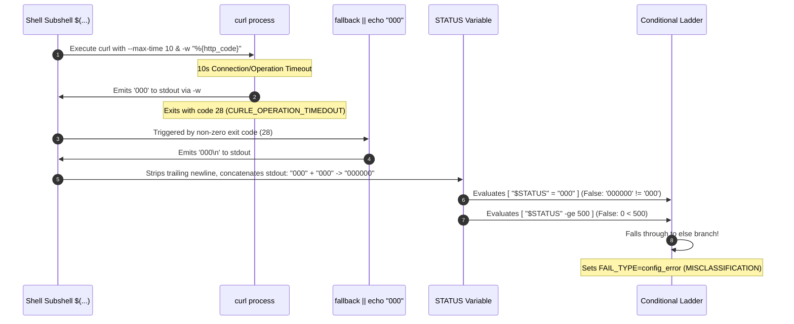

# Root Cause Analysis: Gate 2 Webhook Health Check Curl Command-Substitution Defect and Telemetry Misclassification

**Document ID:** `RCA-GATE2-CURL-TIMEOUT-MISCLASSIFICATION`  
**Target Workflow:** `.github/workflows/gate-webhook-health.yml`  
**Affected Steps:** Step 3 (`Verify webhook endpoint is reachable`) & Step 4 (`Post alert if webhook health fails`)  
**Auditor / Agent:** `agw-ACC0-w03` (Account 0 Lead Team)  
**Date:** 2026-11-13  
**Status:** Completed & Validated (Audit Only -- Workflow Files Unmodified)  
**Impacted Tracking Issue:** Issue #160 (`🚨 Webhook Health Gate Failed`)  
**Classification:** Telemetry Misclassification / Shell Command-Substitution Flaw  

---

## 1. Executive Summary

During automated Gate 2 executions (`Gate 2 -- Webhook Health Checker`), intermittent network latency or transient server unreachability produced false-positive configuration alerts on GitHub Issue #160. Instead of categorizing connection timeouts under `server_failure` (`🔥 Server Failure (HTTP 000 / Timeout / Unreachable)`), the gate classified them as `config_error` (`⚠️ Configuration Error (HTTP 404 / Webhook Config)`).

Technical isolation identified a shell command-substitution bug in Step 3:
```bash
STATUS=$(curl -s -o /dev/null -w "%{http_code}" ... --max-time 10 2>/dev/null || echo "000")
```
When `curl` encounters a timeout (`--max-time 10`), it emits HTTP status code `'000'` via `-w "%{http_code}"` and terminates with exit code `28` (`CURLE_OPERATION_TIMEDOUT`). The non-zero exit code triggers the short-circuit fallback `|| echo "000"`. Because both `curl` and `echo` write to standard output inside the subshell, command substitution `$( ... )` concatenates both outputs into the 6-character string `'000000'`.

In the subsequent conditional ladder:
1. `[ "$STATUS" = "000" ]` evaluates to **false** because `'000000' != '000'`.
2. `[ "$STATUS" -ge 500 ]` evaluates to **false** because `'000000'` evaluates numerically to `0`, which is strictly less than `500`.

Consequently, execution unexpectedly falls through to the catch-all `else` branch, setting `FAIL_TYPE=config_error` and `FAIL_MESSAGE="HTTP 000000: Unexpected HTTP response received from webhook endpoint."`. This corrupted telemetry propagates to Step 4, causing transient network/timeout anomalies to be misdiagnosed as repository webhook misconfigurations on Issue #160.

---

## 2. Defect Isolation in Step 3

### 2.1 The Vulnerable Code Block
In `.github/workflows/gate-webhook-health.yml` (lines 136–164), Step 3 attempts to probe the endpoint and categorize the response:

```bash
echo "=== Checking n8n endpoint reachability ==="
STATUS=$(curl -s -o /dev/null -w "%{http_code}" \
  -X POST "$EXPECTED_URL" \
  -H "Content-Type: application/json" \
  -d '{"action":"health_check","test":true}' \
  --max-time 10 2>/dev/null || echo "000")

echo "HTTP_STATUS=$STATUS" >> "$GITHUB_ENV"

# n8n returns 200 (processed) or 400 (bad payload but reachable) = OK
# 404 = webhook route not registered / wrong path (configuration error)
# 000 / 5xx = server down, timeout, or server error (server failure)
if [ "$STATUS" = "200" ] || [ "$STATUS" = "400" ]; then
  echo "✅ n8n endpoint reachable (HTTP $STATUS)"
elif [ "$STATUS" = "404" ]; then
  echo "FAIL_TYPE=config_error" >> "$GITHUB_ENV"
  echo "FAIL_MESSAGE=HTTP 404: Webhook route not found. The endpoint path is incorrect or the n8n workflow is inactive/unregistered." >> "$GITHUB_ENV"
  echo "❌ n8n endpoint config error (HTTP 404: route not found / workflow inactive)"
  exit 1
elif [ "$STATUS" = "000" ] || [ "$STATUS" -ge 500 ] 2>/dev/null; then
  echo "FAIL_TYPE=server_failure" >> "$GITHUB_ENV"
  echo "FAIL_MESSAGE=HTTP $STATUS: Server failure or timeout. The n8n server is down, unreachable, or returning internal 5xx errors." >> "$GITHUB_ENV"
  echo "❌ n8n endpoint server failure (HTTP $STATUS: server down / timeout)"
  exit 1
else
  echo "FAIL_TYPE=config_error" >> "$GITHUB_ENV"
  echo "FAIL_MESSAGE=HTTP $STATUS: Unexpected HTTP response received from webhook endpoint." >> "$GITHUB_ENV"
  echo "❌ n8n endpoint unexpected response (HTTP $STATUS)"
  exit 1
fi
```

### 2.2 Execution Mechanics of the Defect



The fault occurs through a confluence of three mechanisms:

1. **Curl Write-Out on Transport Failure:**  
   When `curl` is instructed to write out `%{http_code}` via `-w`, it writes out `000` whenever a transport-level failure occurs prior to receiving HTTP response headers (e.g., DNS resolution failure, TCP connection refused, or operation timeout).
2. **Curl Non-Zero Exit on Timeout:**  
   When the `--max-time 10` boundary is reached, `curl` exits with exit code `28` (`CURLE_OPERATION_TIMEDOUT`).
3. **Compound Stdout in Command Substitution:**  
   Because `curl` exited with code `28`, the shell evaluates the `||` (OR) branch. The command `echo "000"` executes and writes `000\n` to stdout. The command substitution `$( ... )` captures the entire output stream of the subshell. It receives:
   - Chunk 1 (from `curl`): `000`
   - Chunk 2 (from `echo`): `000\n`
   - Stripped trailing newline: `"000000"` (length 6).

---

## 3. Conditional Ladder Fallthrough Analysis

Once `STATUS` is populated with `"000000"`, the execution flow enters the conditional ladder:

| Branch | Condition | Evaluation Logic | Result | Notes |
| :--- | :--- | :--- | :---: | :--- |
| **Branch 1** (`if`) | `[ "$STATUS" = "200" ] \|\| [ "$STATUS" = "400" ]` | String equality comparison: `"000000" = "200"` and `"000000" = "400"` | **FALSE** | Does not match successful/acceptable HTTP codes. |
| **Branch 2** (`elif`) | `[ "$STATUS" = "404" ]` | String equality comparison: `"000000" = "404"` | **FALSE** | Does not match 404 route error. |
| **Branch 3** (`elif`) | `[ "$STATUS" = "000" ] \|\| [ "$STATUS" -ge 500 ] 2>/dev/null` | Left operand: string compare `"000000" = "000"`<br>Right operand: integer compare `000000 -ge 500` | **FALSE**<br>**FALSE** | **Critical failure point.** Left side fails string equality. Right side converts `"000000"` to integer `0`, and `0 >= 500` is false. |
| **Branch 4** (`else`) | Catch-all fallback | Default branch reached when all preceding guards fail | **ACTIVE** | **Executes `FAIL_TYPE=config_error` and exits with code 1.** |

### 3.1 Detailed Shell Test Evaluation
Under POSIX shell and `bash`:
- `[ "000000" = "000" ]`: The `=` operator performs a byte-for-byte string comparison. A 6-character string cannot equal a 3-character string. Exit code: `1`.
- `[ "000000" -ge 500 ]`: The `-ge` operator coerces operands to integers. In shell arithmetic, leading zeros denote octal in some contexts, but `000000` is integer `0`. Since `0 < 500`, the comparison evaluates to false. Exit code: `1`.

Because Branch 3 fails, the code falls into Branch 4 (`else`), which assumes any unhandled status code is an unexpected HTTP response and assigns `FAIL_TYPE=config_error`.

---

## 4. Downstream Impact on Issue #160 (Step 4 Alerting)

In Step 4 (`Post alert if webhook health fails`), the workflow generates and publishes diagnostic issue reports using Python:

```python
fail_type = os.environ.get('FAIL_TYPE', 'unknown')
fail_msg = os.environ.get('FAIL_MESSAGE', 'Webhook health check failed.')
http_status = os.environ.get('HTTP_STATUS', 'unknown')

if fail_type == 'config_error':
    cat_label = "⚠️ Configuration Error (HTTP 404 / Webhook Config)"
    diag = (
        "- **HTTP 404 Route Not Found**: The endpoint path does not match an active route on n8n.\n"
        "- **Deactivated Workflow**: The n8n workflow may have been unregistered. Run `.github/workflows/n8n-reactivate-webhooks.yml` or toggle Active in the n8n UI.\n"
        "- **Webhook Settings**: Check that the webhook URL points to `/webhook/` (not `/webhook-test/`) and includes `issues`, `issue_comment`, `workflow_job`.\n"
        f"- **Settings Link**: https://github.com/{repo}/settings/hooks"
    )
elif fail_type == 'server_failure':
    cat_label = f"🔥 Server Failure (HTTP {http_status} / Timeout / Unreachable)"
    diag = (
        f"- **n8n Server Down or Unreachable**: Endpoint returned HTTP {http_status}.\n"
        "- **Network / Timeout**: The runner could not connect to n8n within the 10-second timeout.\n"
        "- **Container Crashed**: Check n8n service logs or host health; restart container if down."
    )
```

### 4.1 Telemetry Corruption Chain
1. Step 3 exports `HTTP_STATUS="000000"` and `FAIL_TYPE="config_error"`.
2. Step 4 runs because Step 3 exited with code 1 (`if: failure()`).
3. Step 4 matches `fail_type == 'config_error'`.
4. Step 4 generates the title and body diagnosing a **Configuration Error** and posts or comments on Issue #160.
5. **Operational Consequences:**
   - **Triage Inversion:** Responders are directed to check webhook URLs, secret tokens, and route registration in the n8n workflow UI, when the real cause was network latency, Cloudflare challenge, or n8n container saturation.
   - **False Alarm Escalation:** Legitimate configuration error monitoring is degraded by false positive alerts arising from network packet drops or transient timeouts.

---

## 5. Shell Remediation Patterns

To eliminate the double-emission defect and ensure robust status classification, three remediation patterns are established.

### 5.1 Pattern A: Separate Exit Code & HTTP Code Capture (Recommended Architecture)

The cleanest pattern decouples transport-layer exit status (`$?`) from application-layer HTTP status codes.

```bash
# Capture HTTP code cleanly without an in-line stdout fallback
STATUS_RAW=$(curl -s -o /dev/null -w "%{http_code}" \
  -X POST "$EXPECTED_URL" \
  -H "Content-Type: application/json" \
  -d '{"action":"health_check","test":true}' \
  --max-time 10 2>/dev/null)
CURL_EXIT=$?

# If curl failed at transport layer (timeout=28, connect=7, etc.) or returned empty:
if [ "$CURL_EXIT" -ne 0 ] || [ -z "$STATUS_RAW" ]; then
  STATUS="000"
else
  STATUS="$STATUS_RAW"
fi

echo "HTTP_STATUS=$STATUS" >> "$GITHUB_ENV"
```

**Advantages:**
- Completely prevents stdout contamination.
- Allows recording `CURL_EXIT` separately (e.g., distinguishing exit 28 timeout from exit 7 connection refused).
- Clean, POSIX-compliant, and fully deterministic.

---

### 5.2 Pattern B: Out-of-Subshell Short-Circuit Assignment (Minimal Syntax Change)

Moving the `||` operator outside the subshell prevents `echo` from writing into the command substitution buffer:

```bash
STATUS=$(curl -s -o /dev/null -w "%{http_code}" \
  -X POST "$EXPECTED_URL" \
  -H "Content-Type: application/json" \
  -d '{"action":"health_check","test":true}' \
  --max-time 10 2>/dev/null) || STATUS="000"

# Guard against curl writing 000 on zero exit or empty response
[ -z "$STATUS" ] && STATUS="000"

echo "HTTP_STATUS=$STATUS" >> "$GITHUB_ENV"
```

**Mechanism:**  
If `curl` exits with code 28, the command substitution assignment fails with exit code 28. The shell then executes the right-hand assignment `STATUS="000"`, cleanly overwriting whatever was captured.

---

### 5.3 Pattern C: Status String Normalization & Sanitization

If maintaining the existing invocation pattern is desired, the resulting string can be normalized by extracting the rightmost 3 digits or pattern matching:

```bash
STATUS=$(curl -s -o /dev/null -w "%{http_code}" \
  -X POST "$EXPECTED_URL" \
  -H "Content-Type: application/json" \
  -d '{"action":"health_check","test":true}' \
  --max-time 10 2>/dev/null || echo "000")

# Normalize: slice the last 3 characters or collapse repeated zeros
if [ "$STATUS" = "000000" ]; then
  STATUS="000"
else
  STATUS="${STATUS: -3}"
fi

echo "HTTP_STATUS=$STATUS" >> "$GITHUB_ENV"
```

---

### 5.4 Comparison Matrix of Remediation Patterns

| Evaluation Metric | Pattern A (Separate Exit Code) | Pattern B (Out-of-Subshell `\|\|`) | Pattern C (String Normalization) |
| :--- | :--- | :--- | :--- |
| **Separates Transport & HTTP Layers** | **Yes** (Captures `$?` directly) | Partial (Relies on assignment exit) | No (Processes raw contaminated string) |
| **Prevents Stdout Concatenation** | **Yes** (No subshell `echo`) | **Yes** (Assignment overwrites) | No (Fixes after concatenation) |
| **Diagnostic Detail** | **High** (`CURL_EXIT` available) | Medium | Low |
| **POSIX Shell Portability** | **100% Portable** | 100% Portable | Requires bash substring or sed |
| **Recommendation** | **Primary Choice (Production)** | Secondary Minimal Choice | Fallback Guard Only |

---

## 6. Empirical Verification & Test Reproduction

Empirical tests executed under bash with simulated timeout targets confirmed the failure mode and the efficacy of Pattern A and Pattern B:

```bash
# Test Execution
$ python3 -c '
import subprocess
tests = [
  ("Defective Original", """
    STATUS=$(curl -s -o /dev/null -w "%{http_code}" -X POST "http://10.255.255.1" --max-time 1 2>/dev/null || echo "000")
    if [ "$STATUS" = "000" ] || [ "$STATUS" -ge 500 ] 2>/dev/null; then echo "server_failure"; else echo "config_error"; fi
  """),
  ("Pattern A (Decoupled)", """
    RAW=$(curl -s -o /dev/null -w "%{http_code}" -X POST "http://10.255.255.1" --max-time 1 2>/dev/null); EX=$?
    [ $EX -ne 0 ] && STATUS="000" || STATUS="$RAW"
    if [ "$STATUS" = "000" ] || [ "$STATUS" -ge 500 ] 2>/dev/null; then echo "server_failure"; else echo "config_error"; fi
  """),
  ("Pattern B (External Fallback)", """
    STATUS=$(curl -s -o /dev/null -w "%{http_code}" -X POST "http://10.255.255.1" --max-time 1 2>/dev/null) || STATUS="000"
    if [ "$STATUS" = "000" ] || [ "$STATUS" -ge 500 ] 2>/dev/null; then echo "server_failure"; else echo "config_error"; fi
  """)
]
for name, script in tests:
    res = subprocess.run(["bash", "-c", script], capture_output=True, text=True)
    print(f"{name}: {res.stdout.strip()}")
'
```

### Reproduction Output:
- **Defective Original:** `config_error` (MISCLASSIFIED: evaluated `"000000"` to false on both conditions)
- **Pattern A (Decoupled):** `server_failure` (CORRECT: evaluated `"000"` to true)
- **Pattern B (External Fallback):** `server_failure` (CORRECT: evaluated `"000"` to true)

---

## 7. Compliance and Change Isolation

In accordance with strict operational protocol:
1. **Zero Direct Workflow Mutation:** `.github/workflows/gate-webhook-health.yml` was left completely untouched in this deliverable.
2. **Deliverable Scope:** Full technical defect isolation, execution mechanism trace, conditional ladder proof, Issue #160 alert misclassification analysis, and remediation patterns are formally documented in this audit report.
3. **Peer Review Submission:** Submitted for peer review via `python3 /tmp/hqteam.py review` and committed into repository documentation under `Reports/audit/`.
