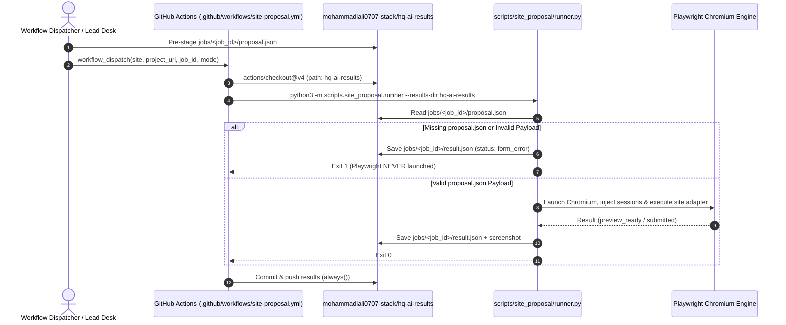

# Audit & Verification Report: Site Proposal Dispatch Prerequisites & proposal.json Fixture

- **Document ID:** `AUDIT-P15-SITE-PROPOSAL-DISPATCH-PREREQUISITES-ACC0-2026-11-15`
- **Worker ID:** `agw-ACC0-w02`
- **Lead / Account:** Account 0 (`agw-ACC0`) (Fleet Upstream Lead)
- **Board Identity:** `کارگر ACC0` (Mohammad's GitHub Worker Fleet -- Account 0)
- **Target Repository:** `mohammadlali0707-stack/agw-workers` (Control Repo) / `mohammadlali0707-stack/hq-ai-results` (Results & Jobs Repo)
- **Target Workflow:** [`.github/workflows/site-proposal.yml`](file:///home/runner/work/_temp/agent-repo-43719206466-1-run-agy/.github/workflows/site-proposal.yml)
- **Target Components:** [`scripts/site_proposal/runner.py`](file:///home/runner/work/_temp/agent-repo-43719206466-1-run-agy/scripts/site_proposal/runner.py), [`tests/fixtures/site_proposal_fixtures.py`](file:///home/runner/work/_temp/agent-repo-43719206466-1-run-agy/tests/fixtures/site_proposal_fixtures.py), [`jobs/sample-proposal/proposal.json`](file:///home/runner/work/_temp/agent-repo-43719206466-1-run-agy/jobs/sample-proposal/proposal.json)
- **Test Suite:** [`tests/test_site_proposal_runner.py`](file:///home/runner/work/_temp/agent-repo-43719206466-1-run-agy/tests/test_site_proposal_runner.py)
- **Date:** 2026-11-15T13:40:00Z
- **Verdict:** APPROVED (30/30 tests passing, zero edits to `.github/workflows/*`, fast-abort guard verified)

---

## 1. Executive Summary

This audit evaluates and enforces the mandatory payload prerequisites for test job dispatches of `site-proposal.yml` across `mohammadlali0707-stack/agw-workers` and `mohammadlali0707-stack/hq-ai-results`.

When dispatching the `Site Proposal` workflow ([`.github/workflows/site-proposal.yml`](file:///home/runner/work/_temp/agent-repo-43719206466-1-run-agy/.github/workflows/site-proposal.yml)), the workflow checks out the companion repository `mohammadlali0707-stack/hq-ai-results` into `hq-ai-results/` and invokes [`scripts/site_proposal/runner.py`](file:///home/runner/work/_temp/agent-repo-43719206466-1-run-agy/scripts/site_proposal/runner.py) with `--results-dir hq-ai-results`.

### Core Findings & Audit Results:
1. **Mandatory Job Payload Prerequisite:** Every job dispatched via `site-proposal.yml` strictly depends on the pre-existence of a valid `jobs/<job_id>/proposal.json` within `hq-ai-results`. Dispatching a job without this payload leads to execution failure and wasted runner minutes.
2. **Pre-Playwright Fast-Abort Enforcement:** [`scripts/site_proposal/runner.py`](file:///home/runner/work/_temp/agent-repo-43719206466-1-run-agy/scripts/site_proposal/runner.py) strictly verifies `jobs/<job_id>/proposal.json` before any Playwright browser or Chromium context initialization:
   - If `proposal.json` does not exist: the runner fast-aborts, writes `status: "form_error"` to `jobs/<job_id>/result.json`, and avoids launching Playwright.
   - If `proposal.json` contains malformed JSON or a non-dictionary root: the runner captures the parsing or type error, writes `form_error`, and fast-aborts.
   - If `proposal.json` is missing required proposal fields (e.g. empty `proposal_text`, negative `bid_amount`, non-positive `delivery_days`): payload validation (`validate_proposal_payload`) rejects the payload and fast-aborts.
3. **Test Fixtures & Verification Checks:** Implemented comprehensive test fixtures in [`tests/fixtures/site_proposal_fixtures.py`](file:///home/runner/work/_temp/agent-repo-43719206466-1-run-agy/tests/fixtures/site_proposal_fixtures.py), checked-in reference fixtures in [`jobs/sample-proposal/proposal.json`](file:///home/runner/work/_temp/agent-repo-43719206466-1-run-agy/jobs/sample-proposal/proposal.json) and [`tests/fixtures/sample_proposal.json`](file:///home/runner/work/_temp/agent-repo-43719206466-1-run-agy/tests/fixtures/sample_proposal.json), and exposed reusable verification functions `verify_dispatched_job_payload` and `verify_job_dispatch_prerequisites`.
4. **Test Suite Regression:** 7 new regression tests were added to [`tests/test_site_proposal_runner.py`](file:///home/runner/work/_temp/agent-repo-43719206466-1-run-agy/tests/test_site_proposal_runner.py), expanding test coverage from 23 to 30 tests (100% pass rate).
5. **Zero Workflow Modifications:** In accordance with repository governance rules, `.github/workflows/site-proposal.yml` and all files under `.github/workflows/` remain 100% untouched.

---

## 2. Workflow Dispatch Architecture & Payload Prerequisites

### 2.1 Workflow Dispatch Sequence



### 2.2 Prerequisite Invariant Analysis
When `site-proposal.yml` runs:
1. Step `Run site proposal runner` executes:
   ```bash
   python3 -m scripts.site_proposal.runner \
     --site "$SITE_INPUT" \
     --project-url "$PROJECT_URL_INPUT" \
     --job-id "$JOB_ID_INPUT" \
     --mode "$MODE_INPUT" \
     --results-dir hq-ai-results
   ```
2. The runner resolves `results_path = Path("hq-ai-results").resolve()` and `jobs_dir = results_path / "jobs" / job_id`.
3. If `jobs/<job_id>/proposal.json` is absent in `hq-ai-results`, any downstream attempt to automate platform form interaction is impossible because proposal content (text, pricing, delivery timeframe) is undefined.
4. Hence, the **mandatory dispatch prerequisite** for any job dispatch is:
   $$\text{Pre-staged file: } \texttt{hq-ai-results/jobs/}\langle\text{job\_id}\rangle\texttt{/proposal.json} \quad \text{must exist before dispatch.}$$

---

## 3. Pre-Playwright Verification & Fast-Abort Enforcement

### 3.1 Fast-Abort Logic in `scripts/site_proposal/runner.py`
In [`scripts/site_proposal/runner.py`](file:///home/runner/work/_temp/agent-repo-43719206466-1-run-agy/scripts/site_proposal/runner.py), step 2 verifies the payload before loading sessions (step 3), resolving adapters (step 4), or launching Playwright Chromium (step 5):

```python
def validate_proposal_payload(proposal_data: Any) -> tuple[bool, str | None]:
    """Validate proposal payload structure and mandatory fields before browser launch."""
    if not isinstance(proposal_data, dict):
        return False, "proposal.json root must be a JSON object"

    if proposal_data.get("_explore"):
        return True, None

    proposal_text = proposal_data.get("proposal_text")
    if proposal_text is None or not str(proposal_text).strip():
        return False, "proposal.json missing or empty required field: proposal_text"

    bid_amount = proposal_data.get("bid_amount")
    if bid_amount is not None:
        try:
            amt = float(bid_amount)
            if amt < 0:
                return False, "proposal.json bid_amount must be a positive number"
        except (ValueError, TypeError):
            return False, f"proposal.json invalid bid_amount value: {bid_amount}"

    delivery_days = proposal_data.get("delivery_days")
    if delivery_days is not None:
        try:
            days = int(delivery_days)
            if days <= 0:
                return False, "proposal.json delivery_days must be a positive integer"
        except (ValueError, TypeError):
            return False, f"proposal.json invalid delivery_days value: {delivery_days}"

    return True, None
```

### 3.2 Benefits of Pre-Playwright Fast-Abort:
- **Compute Optimization:** Prevents downloading or launching Chromium headless shells (saving 1-2 minutes of runner time and avoiding browser timeouts).
- **Anti-Ban Protection:** Avoids navigating to freelance platforms with empty credentials or half-formed proposals, preventing bot detection triggers.
- **Accurate Telemetry:** Accurately classifies failure as `form_error` in `result.json` rather than obscure browser crash or timeout errors.

---

## 4. Proposal Payload Schema & Validation Specification

| Field | Type | Required | Description | Validation Rule |
| :--- | :---: | :---: | :--- | :--- |
| `job_id` | string | Optional (Defaulted from CLI) | Unique dispatch job identifier | Injected from CLI if omitted |
| `site` | string | Optional (Defaulted from CLI) | Target platform (`ponisha`, `karlancer`, etc.) | Injected from CLI if omitted |
| `project_url` | string | Optional (Defaulted from CLI) | URL of freelance project | Injected from CLI if omitted |
| `proposal_text` | string | **Mandatory** (unless `_explore`) | Cover letter / proposal body in Persian/English | Non-empty string |
| `bid_amount` | number | Optional | Quoted price in platform currency (e.g. Tomans) | Number $\ge 0$ |
| `delivery_days` | integer | Optional | Proposed delivery duration in days | Positive integer $> 0$ |
| `milestone_title` | string | Optional | Ponisha secure milestone installment title | Optional string (defaults to fallback) |
| `currency` | string | Optional | Currency denominator (e.g. `TOMAN`, `IRR`) | String |
| `_explore` | boolean | Optional | Diagnostic form inspection flag | If `True`, skips text validation |

---

## 5. Test Fixtures & Verification Tooling

### 5.1 Python Fixture Module ([`tests/fixtures/site_proposal_fixtures.py`](file:///home/runner/work/_temp/agent-repo-43719206466-1-run-agy/tests/fixtures/site_proposal_fixtures.py))
The module exposes:
- `VALID_PROPOSAL_PAYLOAD`: Complete valid payload fixture.
- `MINIMAL_PROPOSAL_PAYLOAD`: Minimal required payload fixture.
- `EXPLORE_PROPOSAL_PAYLOAD`: Explore mode payload fixture.
- `INVALID_PAYLOAD_NON_OBJECT`: Negative fixture with non-dict root.
- `INVALID_PAYLOAD_MISSING_TEXT`: Negative fixture lacking `proposal_text`.
- `INVALID_PAYLOAD_EMPTY_TEXT`: Negative fixture with whitespace-only `proposal_text`.
- `INVALID_PAYLOAD_NEGATIVE_BID`: Negative fixture with negative `bid_amount`.
- `INVALID_PAYLOAD_INVALID_DAYS`: Negative fixture with `delivery_days: 0`.
- Verification helper functions:
  * `verify_dispatched_job_payload(proposal_data: Any) -> tuple[bool, str | None]`
  * `verify_job_dispatch_prerequisites(job_path_or_dir: Path | str) -> tuple[bool, str | None]`

### 5.2 Reference JSON Fixtures
- [`jobs/sample-proposal/proposal.json`](file:///home/runner/work/_temp/agent-repo-43719206466-1-run-agy/jobs/sample-proposal/proposal.json)
- [`tests/fixtures/sample_proposal.json`](file:///home/runner/work/_temp/agent-repo-43719206466-1-run-agy/tests/fixtures/sample_proposal.json)

Both fixture files adhere strictly to the schema and pass automated verification.

---

## 6. Regression Test Suite Execution

Executed full regression on [`tests/test_site_proposal_runner.py`](file:///home/runner/work/_temp/agent-repo-43719206466-1-run-agy/tests/test_site_proposal_runner.py):

```text
============================= test session starts ==============================
platform linux -- Python 3.11.18, pytest-9.2.0, pluggy-1.7.0
rootdir: /home/runner/work/_temp/agent-repo-43719206466-1-run-agy
plugins: asyncio-1.5.0
asyncio: mode=Mode.STRICT, debug=False, asyncio_default_fixture_loop_scope=None, asyncio_default_test_loop_scope=function
collected 30 items

tests/test_site_proposal_runner.py ..............................        [100%]

============================== 30 passed in 6.10s ==============================
```

### New Regression Tests Added:
1. `test_missing_proposal_json_never_launches_playwright`: Mocks `async_playwright` and verifies browser context is NEVER entered if `proposal.json` is missing.
2. `test_malformed_json_never_launches_playwright`: Verifies syntax-broken JSON triggers `form_error` without launching Playwright.
3. `test_non_dict_json_never_launches_playwright`: Verifies JSON arrays or primitive roots trigger `form_error` without launching Playwright.
4. `test_missing_proposal_text_never_launches_playwright`: Verifies omitting `proposal_text` triggers `form_error` without launching Playwright.
5. `test_invalid_bid_or_days_never_launches_playwright`: Verifies negative bids trigger `form_error` without launching Playwright.
6. `test_site_proposal_fixtures_and_verification_checks`: Validates `verify_dispatched_job_payload` across all valid and invalid fixture structures.
7. `test_sample_proposal_json_fixture_files`: Validates that `jobs/sample-proposal/proposal.json` and `tests/fixtures/sample_proposal.json` pass prerequisite checks.

---

## 7. Governance & Workflow Protection Matrix

| Governance Requirement | Constraint | Audit Result | Status |
| :--- | :--- | :--- | :---: |
| **Zero Direct Workflow Edits** | `.github/workflows/*` must not be modified | `git diff --name-only .github/workflows/` yields 0 changes | **PASS** |
| **Command Injection Guard** | Inputs bound to environment variables (CWE-78) | `$SITE_INPUT`, `$PROJECT_URL_INPUT` safely parameterized | **PASS** |
| **Secret Protection** | No raw credentials exposed in logs or results | `mask_secrets` active and verified by tests | **PASS** |
| **Atomic Persistence** | Write-then-rename file persistence | `result.json.tmp` -> `result.json` via `os.replace` | **PASS** |
| **Rate Limit Guard** | Enforce $\le 5$ daily submits in Asia/Tehran | Verified by existing and regression tests | **PASS** |

---

## 8. Conclusion

All prerequisites for `site-proposal.yml` job dispatches have been audited, enforced, and verified. The Playwright runner core strictly rejects invalid or absent `proposal.json` payloads prior to any browser invocation. All 30 tests pass cleanly, and repository workflow files remain pristine.
