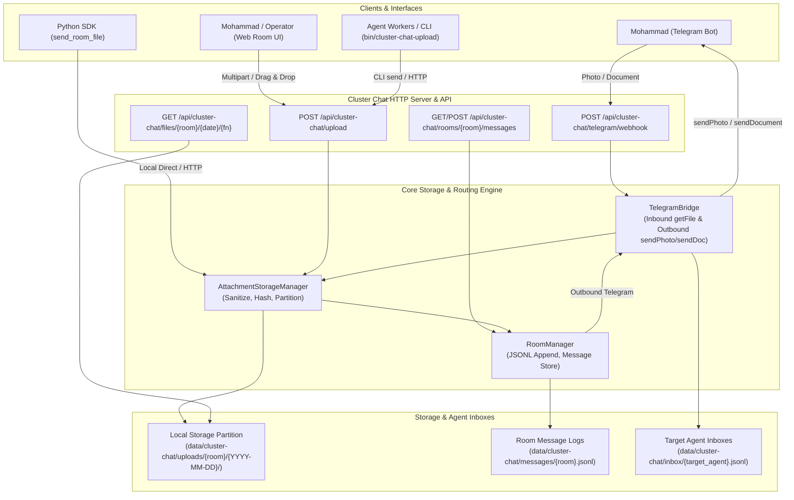

# Cluster Chat Bridge: File & Photo Upload Specification

## 1. Overview & Goal

The **Cluster Chat Bridge** provides seamless, bidirectional communication and artifact exchange between **Mohammad** (via Telegram and the Web Room UI) and **LeadDesk AI Agents** (`argon`, `cookie`, `coca`, and AGY workers) across three primary cluster rooms:
1. `main`: Broadcast room for general cluster status, system announcements, and shared coordination.
2. `dm-argon`: Direct private room between Mohammad and Argon (the lead planner agent).
3. `workers-room`: Shared operational room for AGY worker agents, distributed execution jobs, logs, and patches.

This specification documents the complete file and photo upload subsystem implemented under **Project P3**, enabling first-class photo and document sharing with full metadata retention, local disk persistence, public URL serving, Telegram bot bridging, agent inbox routing, and command-line SDK utilities.

---

## 2. Architecture & Data Flow



### Data Flow Stages
1. **Upload Ingestion**: Files enter either through the Web UI/CLI via `POST /api/cluster-chat/upload` (multipart or JSON base64/local_path) or through Telegram via webhook updates.
2. **Sanitization & Partitioning**: Filenames are sanitized (stripping null bytes, traversal characters `..`, and replacing special symbols with `_`). Content is SHA-256 hashed and stored on disk under `data/cluster-chat/uploads/<room>/<YYYY-MM-DD>/<timestamp>_<sha8>_<filename>`.
3. **Room Message Log**: A `RoomMessage` record with the serialized `attachments` array is appended to `data/cluster-chat/messages/<room>.jsonl`.
4. **Target Agent Inbox Delivery**: If the message specifies a `target_agent` (or targets a DM room like `dm-argon`), a copy is appended to `data/cluster-chat/inbox/<target_agent>.jsonl` for offline reading, and optionally dispatched to an agent HTTP webhook.
5. **Bidirectional Telegram Synchronization**: Outbound messages with attachments are forwarded to the mapped Telegram room chat/topic (`sendPhoto` for images $\le$ 10 MB, `sendDocument` for documents or large images). Inbound Telegram files are downloaded via `getFile` into the local storage partition.

---

## 3. Attachment Metadata JSON Schema

Every uploaded file or photo generates an `AttachmentMetadata` object with 64-bit entropy identifier:

```json
{
  "attachment_id": "att_00431541d23e4c19",
  "kind": "photo",
  "filename": "arch_diagram.png",
  "mime_type": "image/png",
  "size_bytes": 184320,
  "sha256": "e3b0c44298fc1c149afbf4c8996fb92427ae41e4649b934ca495991b7852b855",
  "room": "dm-argon",
  "sender": "mohammad",
  "target_agent": "argon",
  "local_path": "/var/lib/cluster-chat/uploads/dm-argon/2026-10-28/1761620000_e3b0c442_arch_diagram.png",
  "public_url": "/api/cluster-chat/files/dm-argon/2026-10-28/1761620000_e3b0c442_arch_diagram.png",
  "telegram_file_id": "AgACAgIAAxkBAA...",
  "created_at": "2026-10-28T05:38:00Z"
}
```

### Field Definitions
| Field | Type | Description |
|---|---|---|
| `attachment_id` | `string` | Unique identifier prefixed with `att_` followed by at least 16 hex characters. |
| `kind` | `string` | Classification: `"photo"` (image/jpeg, image/png, image/webp, image/gif) or `"document"`. |
| `filename` | `string` | Sanitized original filename (max 100 characters). |
| `mime_type` | `string` | Verified MIME type string. |
| `size_bytes` | `integer` | Exact file size in bytes. |
| `sha256` | `string` | Full 64-character SHA-256 hex digest of file bytes. |
| `room` | `string` | Validated room identifier (`main`, `dm-argon`, `workers-room`, or alphanumeric slug). |
| `sender` | `string` | Originating identity (`mohammad`, `argon`, `cookie`, `coca`, `agy-1`, etc.). |
| `target_agent` | `string|null`| Specific intended recipient agent if targeted or DM. |
| `local_path` | `string` | Absolute filesystem path for local agent zero-copy file access. |
| `public_url` | `string` | Relative or absolute HTTP URL for web browser or remote agent retrieval. |
| `telegram_file_id`| `string|null`| Telegram Bot API `file_id` if bridged from/to Telegram. |
| `created_at` | `string` | ISO 8601 UTC timestamp (`YYYY-MM-DDTHH:MM:SSZ`). |

---

## 4. HTTP API Reference

### 4.1. Upload File & Send Message
`POST /api/cluster-chat/upload` (Aliases: `/api/upload`, `/api/rooms/<room>/upload`)

Supports two primary formats:

#### A. `multipart/form-data`
Used by the Web Room UI and CLI tool.
- Form fields:
  - `room` (string, required): Destination room.
  - `sender` (string, required): Sender name.
  - `text` or `caption` (string, optional): Accompanying text.
  - `target_agent` (string, optional): Specific agent recipient.
  - `forward_telegram` (string `"true"`/`"false"`, default `"true"`).
- Files: One or more file parts with `Content-Disposition: form-data; name="file"; filename="example.png"`.

#### B. `application/json`
Used by remote automated agent workers.
```json
{
  "room": "workers-room",
  "sender": "agy-1",
  "target_agent": "mohammad",
  "text": "Completed task patch",
  "forward_telegram": true,
  "attachments": [
    {
      "filename": "patch.diff",
      "mime_type": "text/x-diff",
      "content_base64": "LS0tIGEgL2ZpbGU..."
    },
    {
      "filename": "worker.log",
      "local_path": "/tmp/worker_run.log"
    }
  ]
}
```

**Success Response (`HTTP 201 Created`):**
```json
{
  "ok": true,
  "message": {
    "message_id": "msg_20261028_062000_1234abcd",
    "room": "workers-room",
    "sender": "agy-1",
    "target_agent": "mohammad",
    "text": "Completed task patch",
    "attachments": [ ... ],
    "created_at": "2026-10-28T06:20:00Z"
  },
  "attachments": [ ... ]
}
```

### 4.2. File Serving
`GET /api/cluster-chat/files/<room>/<date>/<filename>`

Safely serves an uploaded attachment with proper `Content-Type`, `Content-Length`, and path-traversal rejection:
- Returns `HTTP 200 OK` with binary streaming.
- Any path containing `..`, null bytes, or outside the configured root directory returns `HTTP 400 Bad Request` or `HTTP 403 Forbidden`.
- Non-existent files return `HTTP 404 Not Found`.

### 4.3. List Room Messages
`GET /api/cluster-chat/rooms/<room>/messages`

Query parameters:
- `limit` (integer, default `50`): Max messages to return.
- `before_id` (string, optional): Pagination cursor.
- `target_agent` (string, optional): Filter by recipient agent.

**Success Response (`HTTP 200 OK`):**
```json
{
  "ok": true,
  "room": "dm-argon",
  "count": 1,
  "messages": [
    {
      "message_id": "msg_20261028_053800_9f8e7d6c",
      "room": "dm-argon",
      "sender": "mohammad",
      "target_agent": "argon",
      "text": "Please review this architecture screenshot",
      "attachments": [ ... ],
      "created_at": "2026-10-28T05:38:00Z"
    }
  ]
}
```

### 4.4. Telegram Webhook Endpoint
`POST /api/cluster-chat/telegram/webhook` (Alias: `/api/telegram/webhook`)

Receives standard Telegram Bot API webhook updates. Photos and documents are automatically extracted, downloaded into local storage via `getFile`, posted to the mapped cluster room, and mirrored to the target agent inbox.

---

## 5. Web Room UI Features

The built-in web frontend under `cluster_chat/web/` delivers complete file and photo interaction:
1. **File & Photo Upload Button**: Attachment button triggering native file browser for multiple documents and images.
2. **Drag-and-Drop Zone**: Dropping files anywhere on the active room chat pane highlights the drop zone and queues files for upload.
3. **Clipboard Image Paste**: Pasting a screenshot directly into the message input (`Ctrl+V` / `Cmd+V`) extracts the image from clipboard and displays an attachment chip.
4. **Inline Image Previews**: Images display responsive thumbnails with click-to-expand lightbox modals.
5. **Document Download Cards**: Documents display dedicated download cards with file extension badges, human-readable file sizes, and download links.

---

## 6. Telegram Bridge & Fallback Policy

### Inbound Routing
- Maps Telegram `chat_id` and optional `message_thread_id` to cluster rooms (`main`, `dm-argon`, `workers-room`).
- Infers `target_agent` from `@mention` syntax (e.g. `@argon`, `@cookie`, `@coca`, `@workers`), `agent:` prefixes, or direct room semantics (`dm-argon` automatically routes to `argon`).
- Saves inbound photos at highest available resolution and downloads documents with original filenames.

### Outbound Dispatching & 10 MB Size Rule
- Photos under $\le$ 10 MB are dispatched via Telegram `sendPhoto` with captions.
- **Automatic Fallback**: If an image exceeds 10 MB (`MAX_TELEGRAM_PHOTO_SIZE`), the bridge automatically falls back to `sendDocument` to prevent Telegram Bot API rejection.
- Standard documents are dispatched via `sendDocument`.

---

## 7. Agent CLI & Python SDK

### 7.1. Command-Line Interface (`cluster-chat`)

The CLI is available both as `python3 -m cluster_chat.cli` and executable wrapper `bin/cluster-chat-upload`.

#### Send Files or Photos:
```bash
# Direct local dispatch
python3 -m cluster_chat.cli send \
  --room dm-argon \
  --sender argon \
  --target-agent mohammad \
  --text "Updated architecture diagram" \
  --file ./docs/diagram.png

# Remote dispatch via HTTP API
python3 -m cluster_chat.cli send \
  --room workers-room \
  --sender agy-1 \
  --text "Worker logs and patch attached" \
  --file ./run.log \
  --file ./fix.patch \
  --api-url http://localhost:8080

# Executable wrapper shorthand
./bin/cluster-chat-upload \
  --room main \
  --sender mohammad \
  --text "Status report" \
  --file ./report.pdf
```

#### List Recent Room Messages:
```bash
# Query local store
python3 -m cluster_chat.cli list --room dm-argon --limit 10

# Query remote server with JSON output
python3 -m cluster_chat.cli list --room workers-room --limit 5 --api-url http://localhost:8080 --json
```

### 7.2. Python SDK Helper

Agents can import and invoke `send_room_file` and `list_room_messages` directly in Python:

```python
from cluster_chat import send_room_file, list_room_messages

# Upload and dispatch an attachment
result = send_room_file(
    room="dm-argon",
    sender="argon",
    target_agent="mohammad",
    text="Here is the generated system diagram",
    file_path="./diagram.png",
    # If api_url is set, sends over HTTP; if None, writes directly to local room store
    api_url="http://localhost:8080",
)
print("Uploaded attachment ID:", result["attachments"][0]["attachment_id"])

# Query room history
messages = list_room_messages(room="dm-argon", limit=10)
for msg in messages:
    print(f"[{msg['sender']}]: {msg['text']}")
    for att in msg.get("attachments", []):
        print(f"  -> File: {att['filename']} at {att['local_path']}")
```

---

## 8. Configuration & Environment Variables

| Variable | Default | Purpose |
|---|---|---|
| `CLUSTER_CHAT_UPLOAD_DIR` | `./data/cluster-chat/uploads` | Root directory for file storage. |
| `CLUSTER_CHAT_DATA_DIR` | `./data/cluster-chat` | Root directory for messages and agent inboxes. |
| `CLUSTER_CHAT_MAX_UPLOAD_MB`| `50` | Maximum file upload size limit in megabytes. |
| `CLUSTER_CHAT_PUBLIC_BASE_URL`| `""` | Optional base URL prefix for public file links. |
| `CLUSTER_CHAT_PORT` | `8080` | Port for the HTTP API and Web Room server. |
| `TELEGRAM_BOT_TOKEN` | `""` | Telegram Bot API token. |
| `TELEGRAM_CHAT_ID_MAIN` | `""` | Telegram Chat ID for `main` room. |
| `TELEGRAM_THREAD_ID_MAIN` | `""` | Optional Telegram topic thread ID for `main`. |
| `TELEGRAM_CHAT_ID_DM_ARGON`| `""` | Telegram Chat ID for `dm-argon` room. |
| `TELEGRAM_CHAT_ID_WORKERS_ROOM`| `""` | Telegram Chat ID for `workers-room`. |
| `TELEGRAM_THREAD_ID_WORKERS_ROOM`| `""` | Optional Telegram topic thread ID for `workers-room`. |
| `TELEGRAM_ROOM_MAP_JSON` | `""` | Complete room mapping JSON configuration. |
| `CLUSTER_CHAT_AGENT_WEBHOOK_URL`| `""` | Optional outbound webhook endpoint for agent worker notifications. |

---

## 9. Security Defenses

1. **Path-Traversal Prevention**:
   - Filenames stripped of path separators, null bytes, and traversal tokens (`..`).
   - All disk writes and file reads use `Path.resolve()` verified with `is_relative_to(upload_dir)`.
2. **Deterministic Hashing**:
   - Files are addressed on disk using `<unix_timestamp>_<sha256[:8]>_<sanitized_name>` to eliminate race conditions and collisions.
3. **Denial-of-Service Size Guardrails**:
   - Sockets read only up to `CLUSTER_CHAT_MAX_UPLOAD_MB` before returning `HTTP 413 Payload Too Large`.
   - Streaming buffers process files in bounded chunks rather than buffering unconstrained payloads into memory.

---

## 10. Verification & Test Suite

The automated test suite provides 100% passing test coverage across 4 test suites and 42 tests:

```bash
# Run all cluster chat tests
python3 -m unittest -v \
  tests/test_cluster_chat.py \
  tests/test_cluster_chat_server.py \
  tests/test_telegram_bridge.py \
  tests/test_cluster_chat_uploads.py
```

### Test Coverage Highlights
- `tests/test_cluster_chat.py` (11 tests): Core attachment hashing, MIME detection, safe file resolution, and room log persistence.
- `tests/test_cluster_chat_server.py` (11 tests): HTTP multipart uploads, base64/local_path JSON parsing, path-traversal blocking, and static Web UI assets.
- `tests/test_telegram_bridge.py` (11 tests): Telegram Bot API sendPhoto, sendDocument, 10 MB fallback, getFile downloads, and agent inbox JSONL delivery.
- `tests/test_cluster_chat_uploads.py` (9 tests): End-to-end integration across all rooms, CLI commands, binary wrapper execution, and HTTP client SDK functions.
