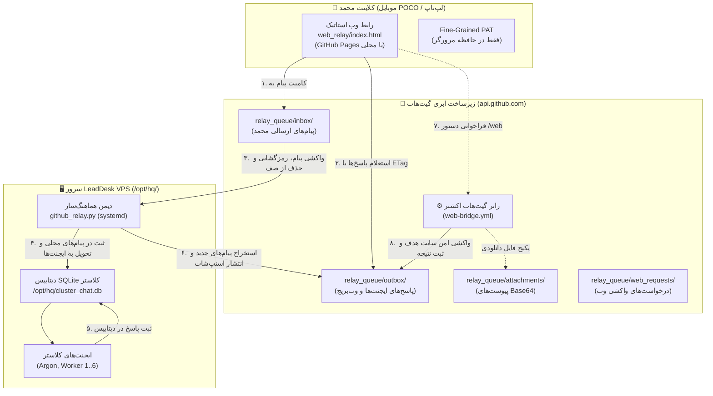

# راهنمای جامع حالت رله گیت‌هاب و پل وب کلاستر چت (GitHub Relay Mode & Web Bridge)

این سند، راهنمای عملیاتی و مرجع کامل برای محمد و تیم لیددسک جهت بهره‌برداری از **حالت رله گیت‌هاب (GitHub Relay Mode)** و **پل وب رانر (Web Bridge)** در سامانه گفتگوی کلاستر (`cluster-chat`) است. این سیستم جهت حفظ پایداری ارتباط و امکان تبادل داده و اینترنت آزاد در شرایط اختلال شدید شبکه و قطعی اینترنت بین‌الملل (شرایط اینترنت ملی ایران) طراحی شده است.

---

## فهرست مطالب
1. [معماری و نحوه کارکرد حالت رله در اینترنت ملی](#۱-معماری-و-نحوه-کارکرد-حالت-رله-در-اینترنت-ملی)
2. [راهنمای ساخت توکن محدود گیت‌هاب (Fine-Grained PAT)](#۲-راهنمای-ساخت-توکن-محدود-گیتهاب-fine-grained-pat)
3. [نحوه راه‌اندازی و استفاده از رابط وب (Web Relay UI)](#۳-نحوه-راهاندازی-و-استفاده-از-رابط-وب-web-relay-ui)
4. [نصب و راه‌اندازی دیمن رله روی سرور VPS با systemd](#۴-نصب-و-راهاندازی-دیمن-رله-روی-سرور-vps-با-systemd)
5. [راهنمای استفاده از پل وب و دستور web/](#۵-راهنمای-استفاده-از-پل-وب-و-دستور-web)
6. [امنیت، رمزنگاری سرتاسری و پاکسازی توکن‌ها](#۶-امنیت-رمزنگاری-سرتاسری-و-پاکسازی-توکنها)
7. [عیب‌یابی سریع و دستورات تشخیصی](#۷-عیبیابی-سریع-و-دستورات-تشخیصی)

---

## ۱. معماری و نحوه کارکرد حالت رله در اینترنت ملی

در زمان وقوع فیلترینگ گسترده یا اختلالات مسیریابی در شبکه زیرساخت کشور، اتصالات مستقیم به آدرس‌های IP سرورهای خارج از کشور (از جمله سرور اختصاصی لیددسک در دیتاسنتر هتزنر/آلمان) مسدود یا دچار افت شدید بسته می‌شوند. با این حال، دسترسی به دامنه‌های اصلی گیت‌هاب نظیر `github.com` و `api.github.com` معمولاً به دلیل نیازهای توسعه‌دهندگان پایدار باقی می‌ماند.

حالت رله از مخزن گیت‌هاب `agw-workers` به عنوان یک صف پیام غیرهمگام (Asynchronous Message Queue) استفاده می‌کند.



### ساختار صف در مخزن گیت‌هاب (`relay_queue/`)
- `relay_queue/inbox/msg_<timestamp>_<id>.json`: پیام‌های ارسال‌شده از سوی رابط وب که منتظر دریافت و پردازش توسط سرور VPS هستند. پس از دریافت موفق توسط سرور، به صورت خودکار از این مسیر پاک می‌شوند تا از انباشت جلوگیری شود.
- `relay_queue/outbox/snapshot_<room>.json`: فایل وضعیت جاری اتاق‌ها (شامل آخرین ۱۰۰ پیام اتاق‌های `main`، `dm-argon` و `workers`). رابط وب با خواندن این فایل، آخرین گفتگوها را دریافت می‌کند.
- `relay_queue/outbox/web_<timestamp>_<id>.json`: نتایج تفکیک‌شده واکشی‌های اینترنت توسط رانر وب‌بریج.
- `relay_queue/attachments/att_<hash>_<name>.json`: تکه‌های فایل و تصاویر پیوست با کدگذاری Base64 (حداکثر ۴ مگابایت).
- `relay_queue/web_requests/req_<id>.json`: صف رزرو درخواست‌های واکشی وب در صورتی که دیسپچ مستقیم به رانر در دسترس نباشد.

---

## ۲. راهنمای ساخت توکن محدود گیت‌هاب (Fine-Grained PAT)

برای اتصال کلاینت وب یا سرور به مخزن، حتماً از توکن با دسترسی محدود استفاده نمایید:

1. به اکانت گیت‌هاب خود وارد شوید و به مسیر زیر بروید:
   `GitHub` > `Settings` > `Developer Settings` > `Personal access tokens` > `Fine-grained tokens`
2. روی دکمه **Generate new token** کلیک کنید.
3. فیلدهای زیر را تکمیل کنید:
   - **Token name:** `cluster-chat-relay`
   - **Expiration:** به دلخواه (مثلاً ۹۰ روز یا ۱ سال)
   - **Repository access:** گزینه **Only select repositories** را انتخاب کرده و مخزن `mohammadlali0707-stack/agw-workers` را انتخاب کنید.
   - **Permissions (دسترسی‌ها):**
     - **Contents:** دسترسی `Access: Read and write` (جهت خواندن و نوشتن فایل‌های صف در `relay_queue/`)
     - **Actions:** دسترسی `Access: Read and write` (جهت دیسپچ و فعال‌سازی گردش‌کار `web-bridge.yml`)
4. دکمه **Generate token** را در پایین صفحه بزنید و توکن تولید شده (`..._github_pat`) را در جایی امن کپی کنید.

> [!IMPORTANT]
> این توکن تنها دارای دسترسی به مخزن `agw-workers` است و هیچ‌گونه دسترسی به ایمیل‌ها، مخازن شخصی دیگر یا تنظیمات حساب کاربری شما ندارد.

---

## ۳. نحوه راه‌اندازی و استفاده از رابط وب (Web Relay UI)

رابط کاربری در پوشه `web_relay/` طراحی شده و کاملاً مستقل (Zero-Dependency) است. هیچ نیازی به اجرای دستور `npm install` یا ساخت سرور نود ندارد.

### روش‌های اجرا
1. **اجرای محلی روی لپ‌تاپ یا گوشی POCO (سریع‌ترین و مطمئن‌ترین حالت):**
   - کافی است فایل `web_relay/index.html` را مستقیماً با مرورگر کروم، فایرفاکس یا مرورگر گوشی باز کنید (`file:///.../web_relay/index.html`).
2. **استقرار روی GitHub Pages:**
   - در تنظیمات مخزن (`Settings > Pages`) منبع استقرار را روی شاخه `main` و مسیر `/web_relay` تنظیم کنید.
   - آدرس صفحه اختصاصی شما به شکل `https://mohammadlali0707-stack.github.io/agw-workers/` در دسترس خواهد بود.

### مراحل اتصال در رابط کاربری
1. در بالای صفحه روی آیکون ⚙️ (تنظیمات) کلیک کنید.
2. فیلدهای زیر را وارد نمایید:
   - **Owner:** `mohammadlali0707-stack`
   - **Repository:** `agw-workers`
   - **Branch:** `main` (یا شاخه رله اختصاصی)
   - **GitHub PAT:** توکن ساخته‌شده در مرحله قبل (`github_pat_...`)
   - **Shared Passphrase:** کلید رمزنگاری مشترک (در صورت تمایل به رمزنگاری AES-256-GCM؛ باید با سرور یکسان باشد)
   - **Poll Interval:** بازه زمانی استعلام (پیش‌فرض ۱۰ ثانیه)
3. دکمه **ذخیره و اتصال** را بزنید.
4. نشانگر وضعیت در بالای صفحه به رنگ سبز درآمده و آخرین پیام‌های اتاق بارگذاری می‌شوند.

### امکانات کاربری
- **اتاق‌های گفتگو:** با کلیک روی زبانه‌های `main`، `dm-argon` و `workers` بین بخش عمومی، گفتگوی مستقیم با آرگون، و عملیات ورکرها جابجا شوید.
- **ارسال پیوست:** با کلیک روی آیکون 📎 فایل‌ها یا تصاویر خود (تا ۴ مگابایت) را پیوست کنید. تصویر به صورت زنده پیش‌نمایش داده می‌شود.
- **صرفه‌جویی در سهمیه گیت‌هاب:** تمام درخواست‌های مرورگر با هدر `If-None-Match` ارسال شده و در صورت نبود پیام جدید (پاسخ `304 Not Modified`) هیچ سهمیه‌ای از ۵۰۰۰ درخواست گیت‌هاب در ساعت مصرف نمی‌شود.

---

## ۴. نصب و راه‌اندازی دیمن رله روی سرور VPS با systemd

روی سرور VPS (`/opt/hq/`)، دیمن هماهنگ‌ساز پیام‌های پایگاه‌داده محلی SQLite و سرور SSE کلاستر را با مخزن همگام می‌کند.

### مراحل نصب
با کاربر `root` یا دسترسی `sudo` وارد سرور شوید:

```bash
# رفتن به پوشه سورس مخزن
cd /path/to/agw-workers

# اجرای اسکریپت نصب خودکار
sudo bash hq/install_github_relay.sh
```

این اسکریپت فایل‌های لازم را به `/opt/hq/` منتقل کرده، دسترسی‌ها را تنظیم و سرویس systemd را ثبت می‌کند.

### تنظیم متغیرهای محیطی
فایل پیکربندی `/opt/hq/github_relay.env` را باز کنید:

```bash
sudo nano /opt/hq/github_relay.env
```

مقادیر را مطابق زیر تنظیم نمایید:

```ini
# توکن گیت‌هاب با دسترسی به Contents و Actions
GITHUB_TOKEN=github_pat_YOUR_TOKEN_HERE

# اطلاعات مخزن و شاخه صف
GITHUB_REPO=mohammadlali0707-stack/agw-workers
GITHUB_BRANCH=main

# مسیر دیتابیس SQLite کلاستر چت
CLUSTER_CHAT_DB=/opt/hq/cluster_chat.db

# آدرس وب‌هوک محلی جهت پخش زنده در اتاق وب (اختیاری)
CLUSTER_CHAT_API_URL=http://127.0.0.1:8090/api/cluster-chat/messages

# کلید رمزنگاری سرتاسری اختیاری (باید دقیقا با کلاینت وب یکسان باشد)
RELAY_SHARED_KEY=YourStrongSecretKey2026

# بازه زمانی استعلام صف بر حسب ثانیه (پیش‌فرض ۸)
RELAY_POLL_INTERVAL=8

# مسیر ذخیره فایلهای دانلودی دریافتی
CLUSTER_CHAT_UPLOAD_DIR=/opt/hq/data/cluster-chat/uploads
```

مجوزهای امنیتی فایل تنظیمات را محدود کنید:
```bash
sudo chmod 600 /opt/hq/github_relay.env
```

### فعال‌سازی و بررسی سرویس
```bash
# فعال‌سازی و راه‌اندازی خودکار در بوت سرور
sudo systemctl daemon-reload
sudo systemctl enable --now leaddesk-github-relay.service

# بررسی وضعیت سرویس
sudo systemctl status leaddesk-github-relay

# مشاهده لاگ‌های لحظه‌ای
sudo journalctl -u leaddesk-github-relay -f -n 50
```

### تست دستی و تشخیصی
برای بررسی بدون اجرای مداوم دیمن:
```bash
# دریافت گزارش وضعیت و شمارش پیام‌ها و صف
python3 /opt/hq/github_relay.py --status

# اجرای یک چرخه آزمایشی تکی
python3 /opt/hq/github_relay.py --once
```

---

## ۵. راهنمای استفاده از پل وب و دستور web/

پل وب (Web Bridge) امکان واکشی صفحات وب و فایل‌ها را از طریق رانرهای خارج از کشور گیت‌هاب فراهم می‌آورد. این قابلیت به محمد اجازه می‌دهد در شرایط ملی بودن اینترنت، به راحتی اطلاعات، مستندات، مقالات و فایل‌ها را از اینترنت آزاد استخراج کند.

### روش‌های فراخوانی

#### ۱. استفاده از دستور چت در هر یک از اتاق‌ها
در کادر متنی هر اتاقی که هستید (`main`، `dm-argon`، `workers`) پیام خود را با `/web` یا `!web` آغاز کنید:

- **واکشی استاندارد مقاله و تبدیل به مارک‌داون:**
  ```text
  /web https://en.wikipedia.org/wiki/Artificial_intelligence
  ```
- **دانلود مستقیم فایل یا PDF به صورت پیوست:**
  ```text
  /web --mode=file https://example.com/research-paper.pdf
  ```
- **استخراج کد خام HTML صفحه:**
  ```text
  /web --mode=html https://example.com/page
  ```
- **تنظیم سقف حجم دریافتی (بر حسب بایت):**
  ```text
  /web --max-bytes=1048576 https://example.com/big-page
  ```

#### ۲. استفاده از دکمه گرافیکی Web Bridge
در نوار بالای رابط کاربری وب، روی دکمه **🌐 Web Bridge** کلیک کرده، آدرس صفحه، حالت و اتاق مقصد را انتخاب کنید و دکمه **اجرای درخواست در رانر** را بزنید.

### گارد امنیت شبکه (SSRF Protection)
اسکریپت `scripts/web_bridge_runner.py` با استانداردهای امنیتی دقیق سخت‌گیرانه اجرا می‌شود و موارد زیر به صورت خودکار مسدود می‌شوند:
- رنج‌های لوکال‌هاست (`127.0.0.1`, `localhost`, `::1`)
- رنج‌های شبکه خصوصی سازمانی (`10.0.0.0/8`, `172.16.0.0/12`, `192.168.0.0/16`)
- آدرس‌های سرویس متادیتای کلود (`169.254.169.254`, `100.100.100.200`)
- دامنه‌های داخلی با پسوندهای `.local`, `.internal`, `.lan`, `.corp`
- پین کردن آی‌پی DNS برای پیشگیری قطعی از حملات DNS Rebinding (TOCTOU)

پاسخ وب پس از استخراج، با قالب مارک‌داون تمیز و عنوان صفحه، کد وضعیت HTTP و حجم دانلود شده مستقیماً در همان اتاق چت ظاهر می‌گردد.

---

## ۶. امنیت، رمزنگاری سرتاسری و پاکسازی توکن‌ها

### ۱. پاکسازی خودکار کلیدها و اسرار (`scrub_secrets`)
تمام پیام‌ها و لاگ‌ها پیش از خروج از کلاینت یا سرور توسط یک فیلتر چندمرحله‌ای پالایش می‌شوند. الگوهای زیر شناسایی و با `[REDACTED_SECRET]` جایگزین می‌گردند:
- توکن‌های کلاسیک و جدید گیت‌هاب (`ghp_...`, `github_pat_...`, `gho_...`)
- کلیدهای Google Gemini / Cloud (`AIza...`)
- توکن‌های ربات تلگرام (`...:A...`)
- هدرهای احراز هویت `Bearer`
- کلیدهای خصوصی PEM (`BEGIN PRIVATE KEY`, `BEGIN RSA PRIVATE KEY`)
- کلیدهای دسترسی OpenAI و AWS

### ۲. رمزنگاری سرتاسری اختیاری (AES-256-GCM)
در صورتی که در تنظیمات رابط وب و فایل `.env` سرور یک عبارت عبور یکسان وارد شود:
- متن پیام‌ها با الگوریتم **AES-256-GCM** و بردار تصادفی (IV) ۱۲ بایتی کدگذاری می‌شوند.
- کلید متقارن با الگوریتم **PBKDF2-HMAC-SHA256** با ۱۰۰,۰۰۰ دور تولید می‌شود.
- سورس کدهای کلاینت جاوااسکریپت (`web_relay/crypto.js`) از طریق استاندارد بومی **WebCrypto** اجرا شده و ۱۰۰٪ با ماژول سرور پایتون (`cluster_chat/relay_protocol.py`) سازگاری بیتی دارد.
- حتی در صورت عمومی بودن مخزن، محتوای پیام‌ها در گیت‌هاب کاملاً مات و غیرقابل رمزگشایی است.

### ۳. حل تعارض همزمانی (Concurrency Conflict Handling)
اگر دو ایجنت یا مرورگر همزمان فایلی در گیت‌هاب تغییر دهند و خطای `409 Conflict` رخ دهد، کلاینت پایتون به صورت خودکار آخرین SHA فایل را از سرور دریافت و با مکانیزم بازتلاش تصاعدی (Exponential Backoff) مجدداً کامیت را انجام می‌دهد.

---

## ۷. عیب‌یابی سریع و دستورات تشخیصی

| وضعیت یا خطا | علت احتمالی | راه حل عملیاتی |
| :--- | :--- | :--- |
| **علامت آفلاین و پیام "اتصال به مخزن برقرار نیست"** | توکن گیت‌هاب وارد نشده یا منقضی شده است. | آیکون ⚙️ را در وب باز کرده و توکن جدید را بررسی کنید. |
| **خطای ۴۰۳ یا ۴۲۹ (Rate Limit Exceeded)** | سهمیه ۵۰۰۰ درخواست گیت‌هاب به اتمام رسیده است. | بررسی بازه استعلام (تنظیم روی ۱۰ یا ۱۵ ثانیه). با فعال بودن ETag، پاسخ‌های ۳۰۴ سهمیه‌ای مصرف نمی‌کنند. |
| **پیام در وب ارسال شده اما پاسخی دریافت نمی‌شود** | سرویس VPS غیرفعال است یا سرور اینترنت ندارد. | اجرای `systemctl status leaddesk-github-relay` روی سرور و بررسی لاگ‌ها با `journalctl`. |
| **خطای Decryption Failed در پیام‌ها** | عبارت عبور رمزنگاری (Shared Passphrase) در وب و سرور مطابقت ندارد. | یکسان‌سازی دقیق کلید در رابط وب و فایل `/opt/hq/github_relay.env`. |
| **دستور web/ پاسخ نمی‌دهد** | دسترسی `Actions: Read and write` در توکن فعال نیست. | بررسی دسترسی توکن گیت‌هاب؛ مطمئن شوید گردش‌کار `web-bridge.yml` اجازه اجرا دارد. |
| **خطای SSRF Security Violation در پاسخ وب** | آدرس درخواست شده جزو رنج‌های خصوصی یا لوکال است. | بررسی آدرس URL؛ آدرس‌های متادیتا و لوکال‌هاست به دلایل امنیتی مسدود می‌شوند. |

### دستورات تشخیصی سریع روی سرور
```bash
# بررسی کلی اتصال به گیت‌هاب و دیتابیس
python3 /opt/hq/github_relay.py --status

# راه‌اندازی مجدد سرویس رله
sudo systemctl restart leaddesk-github-relay

# تست اجرای تست‌های خودکار پایتون در مخزن
pytest -v tests/test_relay_protocol.py tests/test_github_relay_vps.py tests/test_web_bridge_runner.py tests/test_web_relay_static_ui.py
```
