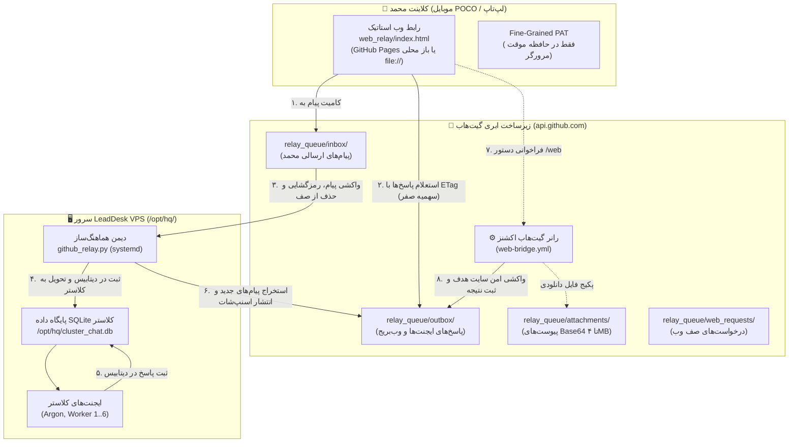

# راهنمای جامع حالت رله گیت‌هاب و پل وب کلاستر چت (GitHub Relay Mode & Web Bridge)

این سند، راهنمای عملیاتی، امنیتی و مرجع جامع برای محمد و تیم لیددسک جهت استقرار، پیکربندی و بهره‌برداری از **حالت رله گیت‌هاب (GitHub Relay Mode)** و **پل وب رانر (Web Bridge)** در سامانه گفتگوی کلاستر (`cluster-chat`) است. این سیستم به منظور تضمین تداوم ارتباطات دوطرفه، تبادل اطلاعات و دسترسی به اینترنت آزاد در شرایط قطعی یا اختلال شدید اینترنت بین‌الملل (شرایط شبکه ملی اطلاعات ایران) طراحی و پیاده‌سازی شده است.

---

## فهرست مطالب
1. [معماری و نحوه کارکرد حالت رله در اینترنت ملی](#۱-معماری-و-نحوه-کارکرد-حالت-رله-در-اینترنت-ملی)
2. [راهنمای ساخت، چرخش و ابطال توکن محدود گیت‌هاب (Fine-Grained PAT)](#۲-راهنمای-ساخت-چرخش-و-ابطال-توکن-محدود-گیتهاب-fine-grained-pat)
3. [نحوه راه‌اندازی و استفاده از رابط وب (Web Relay UI)](#۳-نحوه-راهاندازی-و-استفاده-از-رابط-وب-web-relay-ui)
4. [نصب و پیکربندی دیمن رله روی سرور VPS با systemd](#۴-نصب-و-پیکربندی-دیمن-رله-روی-سرور-vps-با-systemd)
5. [راهنمای استفاده از پل وب رانر و دستور web/](#۵-راهنمای-استفاده-از-پل-وب-رانر-و-دستور-web)
6. [امنیت، رمزنگاری سرتاسری AES-256-GCM و پاکسازی خودکار محرمانه](#۶-امنیت-رمزنگاری-سرتاسری-aes-256-gcm-و-پاکسازی-خودکار-محرمانه)
7. [عیب‌یابی سریع، سناریوهای خطا و دستورات تشخیصی](#۷-عیبیابی-سریع-سناریوهای-خطا-و-دستورات-تشخیصی)
8. [گزارش آزمون‌های خودکار و نتایج پوشش کد (Automated Test Suite)](#۸-گزارش-آزمونهای-خودکار-و-نتایج-پوشش-کد-automated-test-suite)

---

## ۱. معماری و نحوه کارکرد حالت رله در اینترنت ملی

در زمان وقوع فیلترینگ شدید، قطع اینترنت بین‌الملل یا اختلالات عمیق در مسیریابی درگاه‌های اینترنت کشور، ارتباط مستقیم TCP/UDP با آدرس‌های IP سرورهای خارج از کشور (از جمله سرور لیددسک در آلمان) مسدود یا به شدت مخدوش می‌گردد. با این حال، تجارب عملیاتی نشان می‌دهد که دسترسی به دامنه اصلی گیت‌هاب (`github.com`) و سرویس‌های واسط برنامه‌نویسی آن (`api.github.com` و دامنه‌های استاتیک `*.github.io`) پایدار می‌ماند.

حالت رله از مخزن گیت‌هاب به عنوان یک بستر انتقال و صف پیام ناهمگام و تکرارناپذیر (Deduplicated Asynchronous Message Queue) استفاده می‌کند.



### ساختار پوشه‌ها و نام‌گذاری فایل‌ها در صف (`relay_queue/`)
- `relay_queue/inbox/msg_<timestamp_ms>_<short_hash>.json`: پیام‌های ارسال‌شده از سوی کاربر که مقصد آن‌ها سرور VPS است. دیمن سرور پس از دریافت و ثبت موفق این پیام‌ها در SQLite محلی، آن‌ها را بلافاصله از روی مخزن گیت‌هاب حذف (DELETE) می‌کند تا حجم مخزن و صف تمیز بماند.
- `relay_queue/outbox/snapshot_<room>.json`: فایل آخرین وضعیت اتاق‌های سه‌گانه (`main`، `dm-argon` و `workers`) حاوی ۱۰۰ پیام اخیر هر اتاق با ساختار استاندارد `{"ok": true, "room": "<room>", "messages": [...]}`.
- `relay_queue/outbox/web_<timestamp_ms>_<request_id>.json`: پاسخ‌های مستقل رانر وب‌بریج برای درخواست‌های واکشی اینترنت.
- `relay_queue/attachments/att_<sha256_prefix>_<safe_name>.json`: کپسول داده فایل‌های پیوست با کدگذاری Base64 (حداکثر ۴ مگابایت برای هر قطعه فایل).
- `relay_queue/web_requests/req_<request_id>.json`: فایل‌های رزرو درخواست‌های واکشی وب در صورتی که فراخوانی مستقیم گردش‌کار (Workflow Dispatch API) مقدور نباشد.

---

## ۲. راهنمای ساخت، چرخش و ابطال توکن محدود گیت‌هاب (Fine-Grained PAT)

جهت برقراری ارتباط ایمن کلاینت وب یا سرور VPS با مخزن، اکیداً باید از **Fine-Grained Personal Access Token** با محدودترین دامنه دسترسی ممکن استفاده شود. از به کار بردن Classic PAT یا توکن‌های دارای دسترسی همگانی (Full Access) خودداری نمایید.

### مراحل ساخت توکن
1. در حساب گیت‌هاب خود به مسیر زیر بروید:
   `GitHub` > `Settings` > `Developer Settings` > `Personal access tokens` > `Fine-grained tokens`
2. روی دکمه **Generate new token** کلیک کنید.
3. فیلدها را مطابق راهنمای زیر تکمیل نمایید:
   - **Token name:** `cluster-chat-relay` (یا یک نام مشخص برای دستگاه/سرور مورد نظر)
   - **Expiration:** **حداکثر ۳۰ الی ۹۰ روز**. از انتخاب مدت‌های طولانی (مانند ۱ سال یا نامحدود) به دلیل داشتن دسترسی نوشتن اکیداً خودداری فرمایید.
   - **Repository access:** گزینه **Only select repositories** را انتخاب کنید و مخزن کاری خود (پیش‌فرض: `mohammadlali0707-stack/agw-workers` یا فورک/مخزن عملیاتی اختصاصی) را مشخص نمایید.
   - **Repository Permissions (دسترسی‌ها):**
     - **Contents:** دسترسی `Access: Read and write` (جهت خواندن و نوشتن فایل‌های صف در `relay_queue/`)
     - **Actions:** دسترسی `Access: Read and write` (جهت دیسپچ و فعال‌سازی گردش‌کار `web-bridge.yml`)
     - *سایر دسترسی‌ها باید روی `No access` باقی بمانند.*
4. دکمه **Generate token** را در انتهای صفحه بزنید و توکن تولید شده (`github_pat_...`) را کپی و ذخیره کنید.

### چرخش دوره‌ای توکن (Token Rotation)
با توجه به محدودیت ۹۰ روزه توکن:
1. دو هفته پیش از انقضا، یک توکن جدید با همان دسترسی‌ها بسازید.
2. روی سرور VPS فایل پیکربندی را به‌روزرسانی کنید:
   ```bash
   sudo nano /opt/hq/github_relay.env
   # جایگزینی مقدار جدید GITHUB_TOKEN=github_pat_NEW...
   sudo systemctl restart leaddesk-github-relay
   ```
3. در رابط وب کاربری، آیکون ⚙️ را باز کرده و توکن جدید را وارد و ذخیره نمایید.

### ابطال فوری توکن در شرایط اضطراری (Token Revocation)
در صورت مشکوک شدن به نشت توکن:
- بلافاصله به مسیر `Settings > Developer settings > Fine-grained tokens` بروید.
- توکن مربوطه را انتخاب و روی دکمه قرمز **Revoke** کلیک کنید. دسترسی توکن ظرف چند ثانیه در سرتاسر زیرساخت گیت‌هاب قطع خواهد شد.

---

## ۳. نحوه راه‌اندازی و استفاده از رابط وب (Web Relay UI)

کلاینت استاتیک وب در پوشه `web_relay/` به صورت کاملاً مستقل، بدون نیاز به Node.js، فرآیند بیلد یا وب‌سرور خارجی طراحی شده است.

### روش‌های اجرا
1. **اجرای محلی روی سیستم یا موبایل POCO (توصیه‌شده در شرایط قطعی اینترنت):**
   - فایل `web_relay/index.html` را مستقیماً در مرورگر باز کنید (`file:///path/to/repo/web_relay/index.html`).
   - در گوشی‌های اندرویدی (نظیر POCO)، فایل را در مرورگر کروم یا فایرفاکس باز کنید. رابط کاربری برای صفحات لمسی و صفحه کوچک موبایل بهینه‌سازی شده است.
2. **استقرار روی GitHub Pages:**
   - در تنظیمات مخزن (`Settings > Pages`) منبع استقرار را روی شاخه کاری خود (مثلاً `main`) و مسیر `/web_relay` قرار دهید.
   - آدرس صفحه اختصاصی (مانند `https://<owner>.github.io/<repo>/`) فعال خواهد شد.

### تنظیمات اولیه در کلاینت وب
1. روی آیکون ⚙️ (چرخ‌دنده) در بالای صفحه کلیک کنید.
2. فیلدهای اتصال را تنظیم نمایید:
   - **Owner:** نام کاربری یا سازمان مالک مخزن (پیش‌فرض: `mohammadlali0707-stack` یا مالک مخزن شما)
   - **Repository:** نام مخزن رله (پیش‌فرض: `agw-workers`)
   - **Branch:** شاخه صف کاری (پیش‌فرض: `main`)
   - **GitHub PAT:** توکن دسترسی محدود شما (`github_pat_...`)
   - **Shared Passphrase:** کلید رمزنگاری سرتاسری مشترک (در صورت استفاده از رمزنگاری؛ باید با سرور یکی باشد)
   - **Poll Interval:** بازه زمانی استعلام (پیش‌فرض ۱۰ ثانیه، برای صرفه‌جویی ۱۵ ثانیه)
   - **ذخیره دائمی (Remember):** با فعال‌سازی، توکن در `localStorage` و با غیرفعال‌سازی در `sessionStorage` نگهداری می‌شود.
3. دکمه **ذخیره و اتصال** را بفشارید. نشانگر وضعیت سبز شده و آخرین پیام‌های اتاق بارگذاری می‌شوند.

### راهنمای اتاق‌ها و ارسال پیام
- **زبانه‌های اتاق‌ها:**
  - `main`: اتاق عمومی کلاستر برای هماهنگی‌های سراسری و اطلاع‌رسانی.
  - `dm-argon`: اتاق پیام مستقیم به آرگون (برنامه‌ریز و مدیر هوشمند کلاستر).
  - `workers`: اتاق عملیاتی و مانیتورینگ عملکرد ورکرهای ۶گانه.
- **ارسال پیوست:** با کلیک روی آیکون 📎 یا کشیدن و رها کردن فایل، اسناد و تصاویر (تا سقف ۴ مگابایت) را پیوست نمایید. پیش‌نمایش تصویر فوراً قابل مشاهده است.
- **بهینه‌سازی سهمیه با ETag:** تمام استعلام‌های پیام‌ها با هدر `If-None-Match` ارسال شده و پاسخ‌های بدون تغییر (`304 Not Modified`) **سهمیه ۵,۰۰۰ درخواست در ساعت گیت‌هاب را مصرف نمی‌کنند**.

---

## ۴. نصب و پیکربندی دیمن رله روی سرور VPS با systemd

روی سرور LeadDesk VPS (`/opt/hq/`)، یک دیمن پایتون وظیفه دارد صف‌های مخزن گیت‌هاب را پایش کرده و تبادل دوطرفه با پایگاه داده محلی SQLite (`/opt/hq/cluster_chat.db`) و سرور SSE برقرار نماید.

### نصب خودکار با اسکریپت
با کاربر دارای دسترسی ریشه (`sudo`) وارد سرور شوید:

```bash
cd /opt/hq/agw-workers  # یا مسیر کلون مخزن
sudo bash hq/install_github_relay.sh
```

این اسکریپت به صورت خودکار:
- فایل `github_relay.py` و `relay_protocol.py` را در `/opt/hq/` مستقر می‌کند.
- فایل سرویس `leaddesk-github-relay.service` را در `/etc/systemd/system/` قرار می‌دهد.
- دسترسی‌های سیستمی و مجوزهای امنیتی را تنظیم می‌نماید.

### پیکربندی متغیرهای محیطی (`github_relay.env`)
فایل تنظیمات `/opt/hq/github_relay.env` را باز کنید:

```bash
sudo nano /opt/hq/github_relay.env
```

محتوای فایل را مطابق محیط خود تنظیم نمایید:

```ini
# توکن دسترسی گیت‌هاب با مجوزهای Contents و Actions
GITHUB_TOKEN=github_pat_11YOUR_ACTUAL_TOKEN_HERE

# مالک و نام مخزن رله (قابل تغییر به فورک یا محیط آزمایشی)
GITHUB_REPO=mohammadlali0707-stack/agw-workers

# شاخه گیت مورد استفاده برای صف پیام‌ها
GITHUB_BRANCH=main

# مسیر پایگاه‌داده محلی SQLite کلاستر چت
CLUSTER_CHAT_DB=/opt/hq/cluster_chat.db

# وب‌هوک محلی جهت توزیع آنی رویدادها از طریق SSE به کاربران وب کلاستر (اختیاری)
CLUSTER_CHAT_API_URL=http://127.0.0.1:8090/api/cluster-chat/messages

# کلید متقارن رمزنگاری سرتاسری AES-256-GCM (باید با کلاینت وب یکسان باشد)
# هشدار: هرگز از کلیدهای پیش‌فرض یا تستی استفاده نکنید؛ با دستور زیر کلید ۶۴ کاراکتری تصادفی تولید کنید:
#   openssl rand -hex 32
RELAY_SHARED_KEY=

# بازه زمانی استعلام صف مخزن بر حسب ثانیه (پیش‌فرض: ۸)
RELAY_POLL_INTERVAL=8

# مسیر ذخیره فایل‌ها و پیوست‌های دریافتی
CLUSTER_CHAT_UPLOAD_DIR=/opt/hq/data/cluster-chat/uploads
```

> [!CAUTION]
> متغیر `RELAY_SHARED_KEY` در صورت فعال‌سازی، باید یک رشته هگز تصادفی قوی باشد. هرگز از عبارات ساده استفاده نکنید. کلید را می‌توانید با یکی از دستورات زیر بسازید:
> ```bash
> openssl rand -hex 32
> # یا در پایتون:
> python3 -c "import secrets; print(secrets.token_hex(32))"
> ```

تنظیم دسترسی امن فایل محرمانه:
```bash
sudo chmod 600 /opt/hq/github_relay.env
```

### مدیریت سرویس دیمن در systemd
```bash
# بارگذاری مجدد تنظیمات systemd
sudo systemctl daemon-reload

# فعال‌سازی اجرای خودکار هنگام بوت و شروع سرویس
sudo systemctl enable --now leaddesk-github-relay.service

# مشاهده وضعیت زنده سرویس
sudo systemctl status leaddesk-github-relay

# بررسی لاگ‌های زنده دیمن
sudo journalctl -u leaddesk-github-relay -f -n 50
```

### اجرای تست‌های تشخیصی CLI
```bash
# گزارش وضعیت دیتابیس محلی، تعداد پیام‌ها به تفکیک اتاق و وضعیت سینک
python3 /opt/hq/github_relay.py --status

# اجرای یک دور سینک آزمایشی و یک‌مرحله‌ای (مناسب برای کران‌جاب یا دیباگ)
python3 /opt/hq/github_relay.py --once
```

---

## ۵. راهنمای استفاده از پل وب رانر و دستور web/

پل وب (Web Bridge) امکان بهره‌گیری از رانرهای گیت‌هاب اکشنز (مستقر در سرورهای ابری خارج از کشور) را به عنوان پروکسی واکشی محتوا فراهم می‌سازد. این ابزار به محمد اجازه می‌دهد در شرایط ملی بودن اینترنت، مقالات علمی، مستندات فنی و فایل‌های ضروری را بدون فیلتر دریافت نماید.

### سینتکس دستور `/web` یا `!web` در پیام‌ها
در کادر پیام هر یک از اتاق‌های چت (`main`، `dm-argon`، `workers`) دستور مورد نظر را تایپ و ارسال کنید:

- **واکشی صفحه وب و تبدیل به مارک‌داون تمیز (پیش‌فرض):**
  ```text
  /web https://en.wikipedia.org/wiki/Distributed_computing
  ```
- **دانلود فایل باینری، PDF یا تصویر به صورت پیوست:**
  ```text
  /web --mode=file https://example.com/reports/q3_metrics.pdf
  ```
- **مشاهده کدهای خام HTML صفحه:**
  ```text
  /web --mode=html https://example.com/api/page
  ```
- **محدودسازی حجم دریافت محتوا (بر حسب بایت):**
  ```text
  /web --max-bytes=1048576 https://example.com/large-article
  ```
- **فرمت لینک مارک‌داون:**
  ```text
  /web [مستندات معماری](https://example.com/docs/arch)
  ```

### پنجره گرافیکی Web Bridge
در کلاینت وب، با فشردن دکمه **🌐 Web Bridge** در بالای صفحه، فرم گرافیکی باز شده و امکان وارد کردن URL، انتخاب نوع خروجی (Markdown / HTML / File)، سقف حجم و اتاق مقصد فراهم است.

### سپرهای امنیتی ضد SSRF در رانر
اسکریپت `scripts/web_bridge_runner.py` با لایه‌های دفاعی سخت‌گیرانه اجرا شده و حملات جعل درخواست سمت سرور (SSRF) را مسدود می‌کند:
- مسدودسازی آدرس‌های لوکال (`127.0.0.1`, `localhost`, `::1`)
- مسدودسازی شبکه‌های خصوصی سازمانی (`10.0.0.0/8`, `172.16.0.0/12`, `192.168.0.0/16`)
- مسدودسازی سرویس‌های متادیتای کلود (`169.254.169.254`, `100.100.100.200`, `metadata.google.internal`)
- مسدودسازی پروتکل‌های غیر وب نظیر `file://`, `ftp://`, `gopher://`
- پین کردن آی‌پی حل‌شده در مرحله DNS و اتصال مستقیم به آن با هندلرهای `PinnedHTTPConnection` و `PinnedHTTPSConnection` جهت خنثی‌سازی کامل حملات DNS Rebinding و آسیب‌پذیری‌های زمان بررسی تا زمان استفاده (TOCTOU).

---

## ۶. امنیت، رمزنگاری سرتاسری AES-256-GCM و پاکسازی خودکار محرمانه

### ۱. فیلتر خودکار پاکسازی اسرار (`scrub_secrets`)
قبل از خروج هر داده‌ای از سرور VPS یا مرورگر وب، متن پیام‌ها و لاگ‌ها از صافی عبارات منظم عبور کرده و موارد زیر به طور کامل با `[REDACTED_SECRET]` جایگزین می‌گردند:
- کلیدهای دسترسی گیت‌هاب (`ghp_...`, `github_pat_...`, `gho_...`, `ghs_...`)
- کلیدهای Google Gemini / Cloud (`AIza...`)
- توکن ربات‌های تلگرام (`<bot_id>:<token>`)
- هدرهای احراز هویت `Bearer`
- کلیدهای خصوصی رمزنگاری PEM (`BEGIN PRIVATE KEY`, `BEGIN RSA PRIVATE KEY`)
- کلیدهای OpenAI (`sk-...`) و کلیدهای AWS (`AKIA...`)

### ۲. رمزنگاری سرتاسری AES-256-GCM
در صورتی که متغیر `RELAY_SHARED_KEY` در سرور و فیلد Shared Passphrase در مرورگر ست شود:
- هر پیام با یک کلید ۲۵۶ بیتی منحصربه‌فرد که از طریق **PBKDF2-HMAC-SHA256** با ۱۰۰,۰۰۰ دور از عبارت عبور مشتق شده است، رمزنگاری می‌شود.
- برای هر پیام یک Salt تصادفی ۱۶ بایتی و یک IV تصادفی ۱۲ بایتی تولید می‌شود.
- تگ اعتبارسنجی ۱۶ بایتی صحت داده‌ها را تضمین می‌کند و هرگونه دستکاری یا استفاده از عبارت عبور نادرست با خطای اعتبارسنجی رد می‌شود.
- پیاده‌سازی جاوااسکریپت با **WebCrypto API** استاندارد مرورگر (`crypto.subtle`) و پیاده‌سازی سرور با ماژول رمزنگاری پایتون کاملاً همخوان و متقابلاً سازگار است.

### ۳. مدیریت تداخل همزمانی در گیت (409 Conflict Retry)
هنگامی که چند ایجنت یا مرورگر همزمان قصد کامیت در یک شاخه یا به‌روزرسانی اسنپ‌شات اتاق را داشته باشند و گیت‌هاب خطای `HTTP 409 Conflict` بازگرداند:
- کلاینت پایتون به صورت خودکار آخرین SHA فایل مورد نظر را مجدداً استعلام می‌کند.
- پیام‌های جدید را با پیام‌های قبلی ادغام کرده و با وقفه تصاعدی (Exponential Backoff) تا ۳ بار تلاش مجدد انجام می‌دهد تا داده‌ای از دست نرود.

---

## ۷. عیب‌یابی سریع، سناریوهای خطا و دستورات تشخیصی

جدول زیر راه‌حل‌های عملیاتی برای مواجهه با خطاهای رایج در سیستم رله را ارائه می‌دهد:

| وضعیت / کد خطا | علت ریشه‌ای احتمالی | اقدام و راه‌حل رفع مشکل |
| :--- | :--- | :--- |
| **آفلاین بودن و نمایش "اتصال به مخزن برقرار نیست"** | توکن گیت‌هاب خالی است، اشتباه تایپ شده یا منقضی شده است. | آیکون ⚙️ را در وب باز کنید و توکن جدید `github_pat_...` را وارد و دکمه ذخیره را بزنید. |
| **خطای HTTP 401 Unauthorized** | توکن وارد شده نامعتبر است یا در گیت‌هاب باطل شده است. | به تنظیمات گیت‌هاب مراجعه و بررسی کنید آیا توکن منقضی یا باطل شده است؛ توکن جدید تولید کنید. |
| **خطای HTTP 403 Forbidden / Rate Limit** | سقف درخواست‌های ۵,۰۰۰ تایی در ساعت پر شده یا دسترسی مخزن ناکافی است. | بررسی بازه استعلام (روی ۱۰ الی ۱۵ ثانیه تنظیم شود). با هدر ETag پاسخ‌های ۳۰۴ سهمیه‌ای مصرف نمی‌کنند. دسترسی Contents و Actions توکن را بررسی کنید. |
| **خطای HTTP 404 Not Found در درخواست‌ها** | نام مالک، مخزن یا شاخه اشتباه وارد شده یا پوشه `relay_queue/` هنوز در مخزن ایجاد نشده است. | در فرم تنظیمات، مقادیر `Owner` و `Repository` و `Branch` را بررسی کنید. با دستور `git commit` یک فایل خالی در `relay_queue/` اضافه کنید. |
| **پیام در وب ارسال شده اما پاسخی از ایجنت‌ها نمی‌آید** | سرویس `leaddesk-github-relay` روی سرور متوقف شده یا سرور اینترنت ندارد. | روی سرور دستور `sudo systemctl status leaddesk-github-relay` را بزنید و در صورت نیاز با `sudo systemctl restart leaddesk-github-relay` راه‌اندازی مجدد کنید. |
| **خطای Decryption Failed در دریافت پیام‌ها** | عبارت عبور رمزنگاری (Shared Passphrase) در کلاینت وب و سرور VPS یکسان نیست. | کلید را بررسی کرده و مطمئن شوید دقیقاً همان مقدار در `/opt/hq/github_relay.env` و تنظیمات وب درج شده است. |
| **دستور web/ اجرا نمی‌شود و پاسخی نمی‌آید** | دسترسی `Actions: Read and write` برای توکن گیت‌هاب فعال نشده است. | در صفحه ساخت توکن، مطمئن شوید مجوز Actions روی Read and write قرار دارد تا دیسپچ ورک‌فلو انجام شود. |
| **خطای SSRF Security Violation در پاسخ واکشی وب** | آدرس درخواست‌شده متعلق به لوکال‌هاست، آی‌پی خصوصی یا متادیتای کلود است. | این رفتار امنیتی سیستم است. آدرس واردشده به دلایل امنیتی مسدود شده و باید از دامنه‌های عمومی اینترنت استفاده شود. |
| **خطای Database Locked در سرور SQLite** | چند فرآیند همزمان در حال نگارش در دیتابیس بدون قفل مناسب هستند. | دیمن رله دارای مکانیزم قفل تراکنش است؛ سرویس‌های متفرقه را بررسی کنید که اتصال باز بدون کامیت باقی نگذاشته باشند. |

### دستورات تشخیصی سریع سرور (Quick Diagnostic Cheat Sheet)
```bash
# ۱. بررسی سلامت و آمارهای کلی دیمن رله
python3 /opt/hq/github_relay.py --status

# ۲. مشاهده ۵۰ خط آخر لاگ‌های سرویس در systemd
sudo journalctl -u leaddesk-github-relay -n 50 --no-pager

# ۳. بررسی متغیرهای محیطی سرویس رله
sudo systemctl show leaddesk-github-relay --property=Environment

# ۴. راه‌اندازی مجدد سرویس رله
sudo systemctl restart leaddesk-github-relay

# ۵. اجرای آزمون‌های واحد و یکپارچگی رله در مخزن
pytest -v tests/test_relay_protocol.py tests/test_github_relay_vps.py tests/test_web_bridge_runner.py tests/test_web_relay_static_ui.py
```

---

## ۸. گزارش آزمون‌های خودکار و نتایج پوشش کد (Automated Test Suite)

مجموعه آزمون‌های جامع در پوشه `tests/` تمامی اجزای پیاده‌سازی‌شده در فازهای ۱ تا ۴ پروژه P7 را پوشش داده و با موفقیت ۱۰۰٪ اجرا می‌گردند:

| ماژول آزمون | تعداد آزمون‌ها | حیطه پوشش و اعتبارسنجی | وضعیت |
| :--- | :---: | :--- | :---: |
| `tests/test_relay_protocol.py` | ۳۷ | اعتبارسنجی انولوپ پیام، هش قطعی `msg_id`، پاکسازی اسرار (PAT, AIza, Bot, PEM, Bearer)، رمزنگاری و رمزگشایی متقارن AES-256-GCM، پارسر دستورات `/web` | ✅ PASSED |
| `tests/test_github_relay_vps.py` | ۱۳ | سازگاری پویای اسکیما SQLite، سینک دوجهته این‌باند و اوت‌باند، کشینگ ETag (پاسخ‌های ۳۰۴)، بازتلاش خودکار تعارض همزمانی ۴۰۹، خلاصه تشخیصی | ✅ PASSED |
| `tests/test_web_bridge_runner.py` | ۲۲ | تست ۲۱ بردار حمله SSRF (لوکال، خصوصی، متادیتا، CGNAT)، پارسر HTML به Markdown، پکیج فایل‌های باینری در پیوست‌ها، پردازش صف `web_requests/` | ✅ PASSED |
| `tests/test_web_relay_static_ui.py` | ۹ | اعتبارسنجی ساختار HTML/CSS/JS رابط وب، سازگاری رمزنگاری دوطرفه پایتون و Node.js (WebCrypto)، انطباق بیتی `computeMsgId` و `scrubSecrets` | ✅ PASSED |
| **مجموع آزمون‌های رله P7** | **۸۱** | **پوشش کامل پروتکل، دیمن، رانر، کلاینت وب و رمزنگاری** | **✅ ۱۰۰٪** |
| **مجموع با رگرسیون کلاستر چت** | **۱۳۰** | **آزمون‌های کامل سرور، CLI، آپلود و رله کلاستر چت بدون هیچ رگرسیونی** | **✅ ۱۰۰٪** |

برای اجرای تمام آزمون‌های رله:
```bash
pytest -v tests/test_relay_protocol.py tests/test_github_relay_vps.py tests/test_web_bridge_runner.py tests/test_web_relay_static_ui.py
```
خروجی استاندارد تایید شده:
```text
============================== 81 passed in 1.03s ==============================
```
