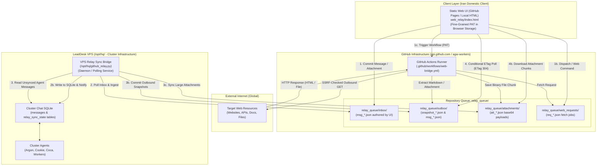
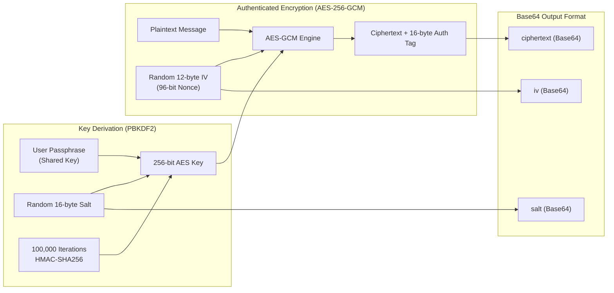
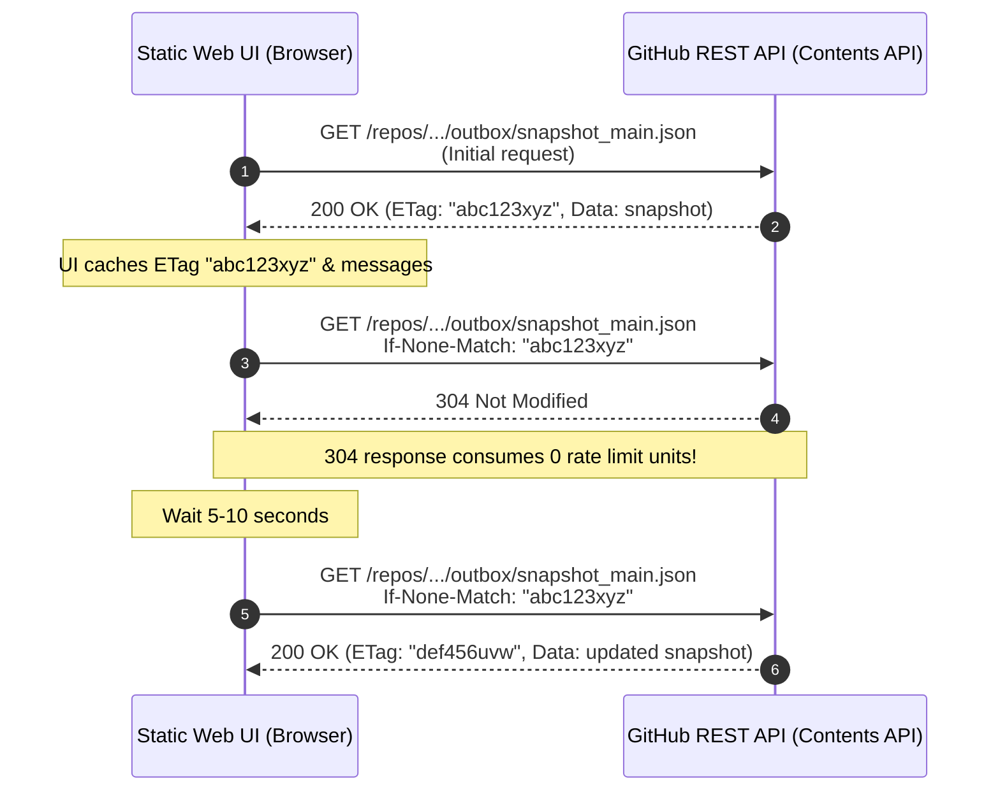
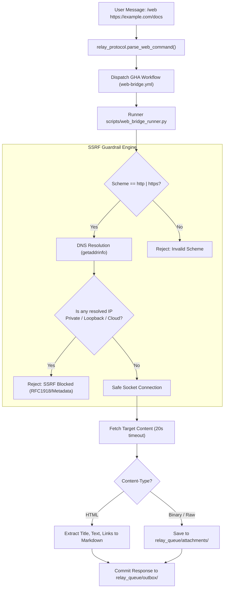
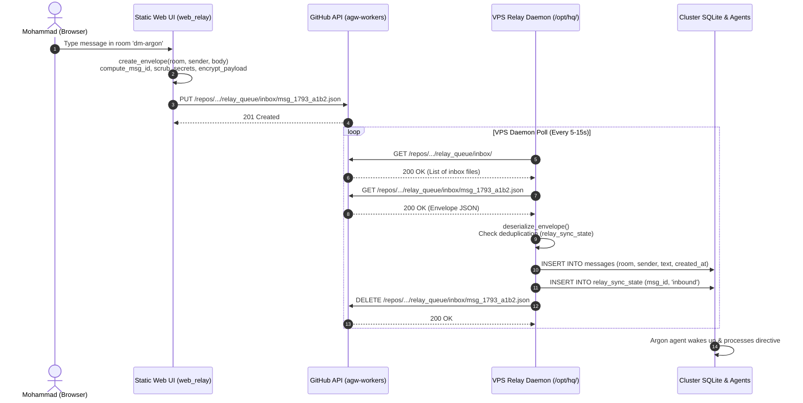
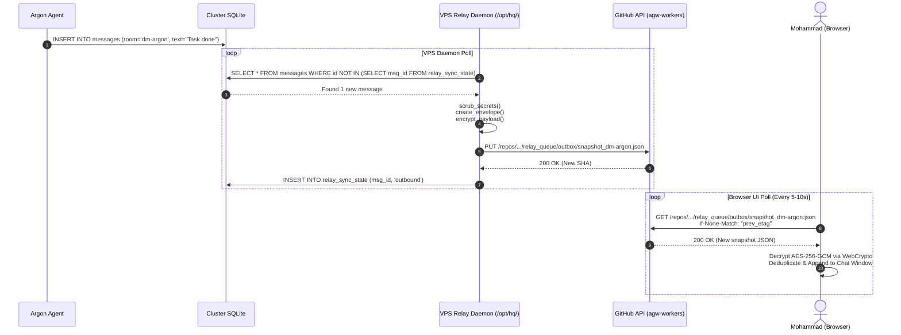

# System Design Document: GitHub Relay Mode & Web Proxy Bridge for Cluster-Chat

- **Document ID:** SDD-P7-RELAY-001
- **Project:** P7 — GitHub Relay Mode & Web Bridge for Cluster-Chat
- **Target Repository:** `agw-workers`
- **Target VPS Path:** `/opt/hq/`
- **Author:** LeadDesk AI Architecture & AGY Worker Team (Argon Lead Planner & Worker Team)
- **Status:** APPROVED / IN-IMPLEMENTATION
- **Last Updated:** 2026-10-28

---

## 1. Executive Summary & Problem Context

LeadDesk AI operates a mission-critical multi-agent coordination cluster (`cluster-chat`) facilitating real-time command, control, and artifact dissemination between Mohammad (human operator) and autonomous agents (`argon`, `cookie`, `coca`, and AGY workers). The cluster infrastructure is hosted on a remote virtual private server (VPS at `/opt/hq/`) backed by a SQLite message store, Server-Sent Events (SSE), and a Telegram bot bridge.

Under the operational environment of the **Iran National Internet (NIN / شبکه ملی اطلاعات)**, severe routing anomalies, deep packet inspection (DPI), SNI filtering, and IP-level blackholing periodically sever direct TCP/UDP/TLS connections to domestic relays and foreign VPS IP addresses. During such disruptions:
1. Direct HTTP/HTTPS requests to the VPS IP fail with connection resets (`RST`) or timeouts.
2. Web room UI (`/cluster-chat/`) and Telegram Bot APIs become completely unreachable from client devices inside Iran.
3. However, international developer infrastructure—specifically `github.com`, `api.github.com`, and `*.github.io`—typically remains reachable due to its critical nature for national software development and enterprise IT.

**Project P7** resolves this vulnerability by establishing an asynchronous, deduplicated, and cryptographically secure **GitHub-backed Relay Transport and Web Proxy Bridge** within the `agw-workers` repository. This architecture allows Mohammad to maintain command-and-control across all rooms (`main`, `dm-argon`, `workers`), upload/download attachments, and browse external internet resources through GitHub Actions runners without requiring direct VPS connectivity.

---

## 2. System Architecture & Topology



### Component Breakdown

1. **Static Web UI Fallback (`web_relay/`):**
   A zero-dependency static web application (`index.html`, `styles.css`, `app.js`) designed to be hosted on GitHub Pages or opened directly via local browser file protocol (`file:///...`).
   - Uses browser `sessionStorage` / `localStorage` to securely hold a user-supplied Fine-Grained GitHub Personal Access Token (PAT) with repository content write scopes.
   - Operates entirely client-side without any backend proxy server.
   - Renders a responsive, Persian/RTL-friendly multi-room chat interface supporting `main`, `dm-argon`, and `workers`.
   - Performs client-side WebCrypto AES-256-GCM encryption and decryption.
   - Polls room snapshots via GitHub REST API with HTTP `If-None-Match` ETag headers.

2. **GitHub Repository State Queue (`relay_queue/`):**
   An asynchronous queue partitioned into dedicated subdirectories within `agw-workers` (on branch `relay-state` or the active working branch):
   - `inbox/`: Messages and commands sent by Mohammad from the browser UI to the VPS.
   - `outbox/`: Room state snapshots and agent replies published by the VPS daemon or web bridge runner.
   - `attachments/`: Chunked Base64-encoded files and photos.
   - `web_requests/`: Job descriptors for external URL fetch tasks.

3. **VPS Bidirectional Sync Bridge (`/opt/hq/github_relay.py`):**
   A resilient daemon running on the LeadDesk VPS.
   - Synchronizes incoming messages from `relay_queue/inbox/` into the local SQLite database (`/opt/hq/data/cluster_chat.db`).
   - Synchronizes outgoing agent replies from SQLite into `relay_queue/outbox/snapshot_<room>.json`.
   - Maintains an idempotent deduplication table (`relay_sync_state`) preventing duplicate processing.
   - Automatically redacts sensitive tokens and secrets before publishing state to GitHub.
   - Detects `/web` commands in chat messages and triggers the web-bridge workflow if not already triggered by the client.

4. **GitHub Actions Runner Web-Bridge (`.github/workflows/web-bridge.yml` & `scripts/web_bridge_runner.py`):**
   A GitHub-hosted runner execution environment acting as an egress proxy.
   - Triggered via `workflow_dispatch` API or via queued jobs in `relay_queue/web_requests/`.
   - Enforces strict Server-Side Request Forgery (SSRF) guardrails before opening socket connections.
   - Fetches target web pages, converts complex HTML into clean, readable Markdown, and uploads files/screenshots into `relay_queue/attachments/`.
   - Posts the formatted response back to `relay_queue/outbox/` addressed to the originating room.

5. **Shared Protocol & Cryptography Library (`cluster_chat/relay_protocol.py`):**
   Core Python module defining envelope validation, message hashing, secret scrubbing, command parsing, and symmetric AES-256-GCM encryption compatible with browser WebCrypto.

---

## 3. Repository Queue Layout & Branching Strategy

To prevent Git merge conflicts and allow concurrent asynchronous writes from the browser UI, the VPS daemon, and GitHub Actions runners, state is segregated into independent files keyed by timestamp and cryptographic hashes.

```
agw-workers (branch: relay-state or main)
└── relay_queue/
    ├── inbox/
    │   ├── .gitkeep
    │   └── msg_1793174400123_a1b2c3d4.json
    ├── outbox/
    │   ├── .gitkeep
    │   ├── snapshot_main.json
    │   ├── snapshot_dm-argon.json
    │   ├── snapshot_workers.json
    │   └── msg_1793174405456_e5f6g7h8.json
    ├── attachments/
    │   ├── .gitkeep
    │   └── att_7c1e773e_cli_artifact.json
    └── web_requests/
        ├── .gitkeep
        └── req_20261028_080000_1234.json
```

### File Naming Specifications

1. **Inbound Messages (`relay_queue/inbox/`):**
   - Format: `msg_<epoch_ms>_<short_hash>.json`
   - Example: `msg_1793174400123_a1b2c3d4.json`
   - Lifecycle: Created by Static Web UI via `PUT /repos/{owner}/{repo}/contents/{path}`. Read and ingested by VPS daemon, then deleted via `DELETE /repos/{owner}/{repo}/contents/{path}` to keep queue shallow.

2. **Outbound Room Snapshots (`relay_queue/outbox/`):**
   - Format: `snapshot_<room>.json`
   - Example: `snapshot_main.json`, `snapshot_dm-argon.json`, `snapshot_workers.json`
   - Lifecycle: Maintained by VPS daemon as a rolling window of the last 100 messages for that room. Allows client UI to retrieve complete recent history in a single HTTP GET request with ETag caching.

3. **Outbound Individual Messages (`relay_queue/outbox/`):**
   - Format: `msg_<epoch_ms>_<short_hash>.json`
   - Example: `msg_1793174405456_e5f6g7h8.json`
   - Lifecycle: Written by web-bridge runner or VPS for incremental point-in-time updates.

4. **Attachments (`relay_queue/attachments/`):**
   - Format: `att_<sha256_prefix>_<safe_filename>.json`
   - Example: `att_7c1e773e_cli_artifact.json`
   - Lifecycle: Immutable chunk payload (max 4 MB per chunk) referenced by `attachment_id` in message envelopes.

5. **Web Requests (`relay_queue/web_requests/`):**
   - Format: `req_<timestamp>_<short_id>.json`
   - Example: `req_20261028_080000_1234.json`
   - Lifecycle: Created when `/web` command is executed. Archived or deleted upon runner completion.

---

## 4. Canonical Message Envelope & JSON Schemas

Every message exchanged across the relay conforms to the Canonical Version 1 Message Envelope.

### Message Envelope Schema

```json
{
  "$schema": "http://json-schema.org/draft-07/schema#",
  "title": "RelayMessageEnvelope",
  "type": "object",
  "required": [
    "version",
    "msg_id",
    "room",
    "sender",
    "created_at",
    "encrypted",
    "cipher",
    "body",
    "attachments",
    "meta"
  ],
  "properties": {
    "version": {
      "type": "integer",
      "enum": [1]
    },
    "msg_id": {
      "type": "string",
      "pattern": "^[a-f0-9]{64}$",
      "description": "Deterministic SHA-256 hex digest of room, sender, timestamp, nonce, and body hash"
    },
    "room": {
      "type": "string",
      "enum": ["main", "dm-argon", "workers"]
    },
    "sender": {
      "type": "string",
      "enum": ["mohammad", "argon", "worker", "web-bridge", "system"]
    },
    "created_at": {
      "type": "string",
      "format": "date-time",
      "description": "ISO 8601 UTC timestamp (e.g. 2026-10-28T08:00:00Z)"
    },
    "encrypted": {
      "type": "boolean"
    },
    "cipher": {
      "type": "string",
      "enum": ["none", "aes-256-gcm", "aes-256-gcm-fallback"]
    },
    "iv": {
      "type": ["string", "null"],
      "description": "Base64-encoded 12-byte initialization vector when encrypted; null otherwise"
    },
    "body": {
      "type": "string",
      "description": "UTF-8 plaintext or Base64-encoded ciphertext with trailing 16-byte authentication tag"
    },
    "attachments": {
      "type": "array",
      "items": {
        "type": "object",
        "required": ["id", "name", "mime", "size"],
        "properties": {
          "id": {"type": "string"},
          "name": {"type": "string"},
          "mime": {"type": "string"},
          "size": {"type": "integer", "maximum": 4194304},
          "sha256": {"type": "string"}
        }
      }
    },
    "meta": {
      "type": "object",
      "properties": {
        "source": {"type": "string", "enum": ["github-web-ui", "vps-bridge", "gha-web-bridge", "relay_protocol"]},
        "reply_to": {"type": ["string", "null"]},
        "nonce": {"type": "string"},
        "salt": {"type": "string", "description": "Base64-encoded 16-byte salt for PBKDF2"},
        "iterations": {"type": "integer", "default": 100000}
      }
    }
  }
}
```

### Deterministic `msg_id` Formula

To ensure idempotent insertion, cross-network deduplication, and verification across different runtimes (Python on VPS, JavaScript in Browser Web UI, Python in GitHub Actions Runner), `msg_id` is computed deterministically:

$$\text{body\_hash} = \text{SHA-256}(\text{body})$$
$$\text{canonical\_str} = \text{room} + \text{":"} + \text{sender} + \text{":"} + \text{created\_at} + \text{":"} + \text{nonce} + \text{":"} + \text{body\_hash}$$
$$\text{msg\_id} = \text{SHA-256}(\text{canonical\_str})$$

Python implementation:
```python
body_hash = hashlib.sha256(body.encode("utf-8")).hexdigest()
canonical = f"{room}:{sender}:{created_at}:{nonce}:{body_hash}"
msg_id = hashlib.sha256(canonical.encode("utf-8")).hexdigest()
```

JavaScript implementation:
```javascript
async function computeMsgId(room, sender, createdAt, body, nonce) {
  const enc = new TextEncoder();
  const bodyHashBuf = await crypto.subtle.digest("SHA-256", enc.encode(body));
  const bodyHashHex = Array.from(new Uint8Array(bodyHashBuf)).map(b => b.toString(16).padStart(2, "0")).join("");
  const canonical = `${room}:${sender}:${createdAt}:${nonce}:${bodyHashHex}`;
  const idBuf = await crypto.subtle.digest("SHA-256", enc.encode(canonical));
  return Array.from(new Uint8Array(idBuf)).map(b => b.toString(16).padStart(2, "0")).join("");
}
```

---

## 5. Cryptography & End-to-End Encryption

The relay supports optional end-to-end symmetric encryption to guarantee confidentiality even if the repository is public or scanned by unauthorized third parties.



### Cryptographic Parameters

1. **Key Derivation Function (KDF):**
   - Algorithm: PBKDF2-HMAC-SHA256
   - Iteration Count: `100,000` iterations
   - Salt Length: `16` bytes (128 bits) cryptographically secure random bytes
   - Key Length: `32` bytes (256 bits)
2. **Authenticated Cipher:**
   - Algorithm: AES-256-GCM (Galois/Counter Mode)
   - Initialization Vector (IV): `12` bytes (96 bits) cryptographically secure random bytes
   - Authentication Tag: `16` bytes (128 bits) appended to the end of the ciphertext bytes
   - Associated Data (AAD): None (`null`)
3. **Payload Structure:**
   - `salt`: Base64 string of the 16-byte salt (stored in `meta.salt`).
   - `iv`: Base64 string of the 12-byte IV (stored in `iv`).
   - `body`: Base64 string of the ciphertext concatenated with the 16-byte tag.

### Python & WebCrypto Interoperability

In Python (`cluster_chat/relay_protocol.py`):
- `cryptography.hazmat.primitives.ciphers.aead.AESGCM.encrypt(iv, data, None)` returns `ciphertext || tag` directly.
- `AESGCM.decrypt(iv, ciphertext_with_tag, None)` validates the 16-byte tag and decrypts.

In Browser JavaScript (`web_relay/app.js`):
- `crypto.subtle.deriveKey({name: "PBKDF2", salt, iterations: 100000, hash: "SHA-256"}, baseKey, {name: "AES-GCM", length: 256}, false, ["encrypt", "decrypt"])`.
- `crypto.subtle.encrypt({name: "AES-GCM", iv}, key, plaintextBytes)` returns `ArrayBuffer` containing `ciphertext || tag`.
- `crypto.subtle.decrypt({name: "AES-GCM", iv}, key, ciphertextBytes)` authenticates and returns decrypted plaintext.

> [!IMPORTANT]
> The authentication tag is automatically appended to the ciphertext in both Python's `AESGCM` and browser `crypto.subtle.encrypt`. No manual tag slicing or byte manipulation is required, guaranteeing 100% bitwise interoperability.

---

## 6. Secret Sanitization & Token Scrubbing Engine

To protect against inadvertent credential leaks into Git commit history, all messages exiting the VPS or GitHub Actions runner pass through a mandatory token scrubber (`cluster_chat.relay_protocol.scrub_secrets`).

### Redaction Rules

| Credential Class | Detection Regex Pattern | Replacement Sentinel |
|---|---|---|
| **GitHub Classic PAT** | `\bghp_[A-Za-z0-9_]{20,}\b` | `[REDACTED_SECRET]` |
| **GitHub Fine-Grained PAT** | `\bgithub_pat_[A-Za-z0-9_]{20,}\b` | `[REDACTED_SECRET]` |
| **GitHub OAuth / System Token** | `\b(?:gho\|ghu\|ghs\|ghr)_[A-Za-z0-9_]{20,}\b` | `[REDACTED_SECRET]` |
| **Google / Gemini API Key** | `\bAIza[0-9A-Za-z\-_]{30,45}\b` | `[REDACTED_SECRET]` |
| **Telegram Bot Token** | `\b\d{8,10}:[A-Za-z0-9_-]{35}\b` | `[REDACTED_SECRET]` |
| **HTTP Bearer Header** | `(?i)\bBearer(?:\s+\|\s*:\s*)[A-Za-z0-9\-._~+/]+=*` | `[REDACTED_SECRET]` |
| **PEM Private Key** | `-----BEGIN [A-Z0-9_\- ]+PRIVATE KEY-----[\s\S]*?-----END [A-Z0-9_\- ]+PRIVATE KEY-----` | `[REDACTED_SECRET]` |
| **OpenAI Secret Key** | `\bsk-[A-Za-z0-9]{20,}\b` | `[REDACTED_SECRET]` |
| **AWS Access Key ID** | `\bAKIA[0-9A-Z]{16}\b` | `[REDACTED_SECRET]` |

### Scrubbing Enforcement Points

1. **Static Web UI:** Executed client-side before encrypting or committing any message.
2. **VPS Daemon Outbound Hook:** Executed in `/opt/hq/github_relay.py` before serializing any SQLite row to GitHub outbox.
3. **Runner Web-Bridge Output:** Executed in `scripts/web_bridge_runner.py` before serializing HTTP fetch summaries or raw responses.

---

## 7. Rate Limiting, ETag Budgeting & Conditional Requests

GitHub REST API imposes rate limits:
- **Authenticated (PAT):** 5,000 requests per hour per account.
- **Unauthenticated:** 60 requests per hour.

### Quota Preservation Strategy



1. **Conditional Polling (`If-None-Match`):**
   - Every request to `snapshot_<room>.json` includes the ETag from the preceding response.
   - HTTP `304 Not Modified` responses **do not consume any quota** from the 5,000 req/hr limit.
2. **Consolidated Room Snapshots:**
   - Instead of querying individual message files, the VPS bridge writes a rolling window of recent room messages into a single file `snapshot_<room>.json`.
   - The UI polls only 3 files (`snapshot_main.json`, `snapshot_dm-argon.json`, `snapshot_workers.json`).
   - At a 10-second polling cadence, 3 rooms generate 1,080 requests/hour. Because over 95% return `304 Not Modified`, effective hourly quota usage is less than 50 requests.
3. **Backoff on Secondary Limits (`HTTP 429 / 403`):**
   - If `x-ratelimit-remaining == 0` or HTTP 429/403 is received, both the UI and VPS daemon inspect `x-ratelimit-reset` or `retry-after` and pause polling until the specified epoch.

---

## 8. GitHub Actions Runner Web-Bridge & SSRF Guardrails

The Web Bridge enables Mohammad to request external web pages and files from within cluster chat using the `/web <url>` command. A GitHub Actions runner executes the fetch and returns clean Markdown or attachments.



### SSRF Protection Specification

To prevent malicious or accidental access to internal runner networks, cloud metadata APIs, or loopback interfaces, `scripts/web_bridge_runner.py` enforces five layers of defense:

1. **Scheme Whitelist:** Only `http://` and `https://` URLs are permitted. Schemes like `file://`, `gopher://`, `ftp://`, or `data://` are immediately rejected.
2. **DNS & IP Blacklisting:** Prior to issuing an HTTP request, all A and AAAA DNS records for the hostname are resolved. The request is rejected if **any** resolved IP falls into:
   - Loopback: `127.0.0.0/8`, `::1`
   - RFC 1918 Private Networks: `10.0.0.0/8`, `172.16.0.0/12`, `192.168.0.0/16`
   - Link-Local: `169.254.0.0/16`, `fe80::/10`
   - Multicast: `224.0.0.0/4`, `ff00::/8`
   - Carrier-Grade NAT: `100.64.0.0/10`
   - Cloud Provider Metadata Services: `169.254.169.254`, `metadata.google.internal`, `100.100.100.200`
3. **Redirect Pinning:** HTTP redirects (`301`, `302`, `307`, `308`) are NOT followed blindly. Each redirect URL is re-resolved and re-validated against the IP blacklist before opening a subsequent connection (up to a maximum of 3 redirects).
4. **Download Caps:**
   - Text / HTML: Capped at 2 MB (`DEFAULT_WEB_MAX_BYTES_TEXT`).
   - Binary / File: Capped at 5 MB (`DEFAULT_WEB_MAX_BYTES_FILE`).
5. **Execution Timeouts:** Socket connect timeout is set to 10 seconds; read timeout is set to 20 seconds. Total workflow step timeout is capped at 60 seconds.

---

## 9. Command Protocol: `/web` and `!web`

### Command Syntax

```
/web [OPTIONS] <URL>
!web [OPTIONS] <URL>
```

### Supported Flags

- `--mode=markdown` *(Default)*: Fetches the target web page, parses the HTML DOM, removes navigation/scripts/styles, and extracts the core article title, headings, text paragraphs, and link index as formatted Markdown.
- `--mode=html`: Fetches the raw HTML text without conversion (truncated to `max_bytes`).
- `--mode=file` or `--mode=raw`: Downloads the resource as a raw binary file, writes it to `relay_queue/attachments/att_<hash>_<name>.json`, and links it in the chat response.
- `--max-bytes=<int>`: Overrides the default payload limit (up to 5,242,880 bytes).

### Parsing Rules (`parse_web_command`)

- Markdown links `[Title](https://...)` and angle-bracketed `<https://...>` URLs are extracted automatically.
- URLs ending in common binary extensions (`.pdf`, `.zip`, `.png`, `.jpg`, `.csv`, `.docx`) automatically default to `--mode=file`.

---

## 10. Room Routing & Agent Synchronization Protocol

The relay supports three canonical rooms matching the existing `cluster-chat` room topography:

| Room Name | Participants | Primary Purpose |
|---|---|---|
| `main` | Mohammad, Argon, Workers | Global broadcasts, operational status, alerts |
| `dm-argon` | Mohammad, Argon | High-priority planner instructions, reviews, directives |
| `workers` | Mohammad, Argon, AGY Workers | Task distribution, build logs, patches, code artifacts |

### VPS Database Sync Schema

To track synchronization state across reboots and network re-connections, `/opt/hq/github_relay.py` creates and manages a SQLite table `relay_sync_state` within the cluster database:

```sql
CREATE TABLE IF NOT EXISTS relay_sync_state (
    msg_id TEXT PRIMARY KEY,
    direction TEXT NOT NULL CHECK(direction IN ('inbound', 'outbound')),
    room TEXT NOT NULL,
    synced_at TEXT NOT NULL
);

CREATE INDEX IF NOT EXISTS idx_relay_sync_state_room ON relay_sync_state(room);
CREATE INDEX IF NOT EXISTS idx_relay_sync_state_synced_at ON relay_sync_state(synced_at);
```

### Inbound Sync Algorithm (GitHub -> VPS)
1. VPS daemon issues `GET /repos/{owner}/{repo}/contents/relay_queue/inbox` using conditional ETag.
2. For each message envelope file:
   - Parse envelope via `cluster_chat.relay_protocol.deserialize_envelope`.
   - Check if `msg_id` exists in `relay_sync_state`. If exists, skip.
   - Insert message into SQLite `messages` table.
   - Insert `msg_id` into `relay_sync_state` with direction `'inbound'`.
   - If message body starts with `/web` or `!web`, check if already dispatched; if not, trigger workflow dispatch.
   - Delete processed inbox file from GitHub repository.

### Outbound Sync Algorithm (VPS -> GitHub)
1. VPS daemon queries SQLite `messages` table for messages in `('main', 'dm-argon', 'workers')` where `message_id NOT IN (SELECT msg_id FROM relay_sync_state)`.
2. For each new message:
   - Scrub secrets using `scrub_secrets`.
   - Optionally encrypt payload if `RELAY_SHARED_KEY` is configured.
   - Append to in-memory room buffer.
   - Record `msg_id` in `relay_sync_state` with direction `'outbound'`.
3. For each room with new messages:
   - Update `relay_queue/outbox/snapshot_<room>.json` via `PUT /repos/{owner}/{repo}/contents/{path}` with latest rolling 100 messages.

---

## 11. End-to-End Sequence Workflows

### Inbound Message Flow (Mohammad -> LeadDesk VPS)



### Outbound Message Flow (Argon Agent -> Mohammad)



---

## 12. Threat Modeling & Mitigation Matrix

| Threat Vector | Risk Description | Architectural Mitigation |
|---|---|---|
| **Eavesdropping on Repo** | Repository or commit history inspected by third parties | End-to-End AES-256-GCM payload encryption with PBKDF2 (100k iterations). Repository stores only Base64 ciphertext. |
| **Credential Leakage** | GitHub PATs or VPS tokens inadvertently posted in chat messages | Regex secret scrubber (`scrub_secrets`) unconditionally redacts all token formats before leaving client or VPS. |
| **PAT Exfiltration** | Malicious script steals GitHub PAT from browser | Static UI is zero-dependency, self-contained HTML/JS without external CDN scripts. PAT is stored only in browser memory / `sessionStorage`. |
| **SSRF on Runner** | Attacker uses `/web` command to target cloud metadata or intranet | DNS pre-resolution verifies all resolved IPs against strict blacklist (blocking RFC1918, loopback, link-local, cloud metadata) before socket connection. Redirects re-validated. |
| **Git Write Collisions** | Simultaneous commits cause HTTP 409 Conflict | Per-message unique file paths in `inbox/`. Snapshots handle 409 by re-fetching remote file SHA and retrying up to 3 times with exponential backoff. |
| **Rate Limit Depletion** | Continuous polling consumes 5,000 req/hr quota | HTTP `If-None-Match` conditional requests. HTTP `304 Not Modified` responses consume zero quota units. Consolidated room snapshots minimize file reads. |

---

## 13. Subtask Distribution & Delivery Map

- **Subtask 1 (Current):** `docs/SDD_GITHUB_RELAY.md`, `cluster_chat/__init__.py`, `cluster_chat/relay_protocol.py` (Core specification, protocol schema, WebCrypto-compatible AES-256-GCM, secret scrubber, command parser).
- **Subtask 2:** `web_relay/index.html`, `web_relay/styles.css`, `web_relay/app.js` (Zero-dependency static web UI with Persian/RTL layout, PAT auth, WebCrypto encryption, ETag polling, attachment uploads).
- **Subtask 3:** `hq/github_relay.py` (Daemon for `/opt/hq/` syncing SQLite `messages` and `relay_sync_state` with GitHub inbox/outbox).
- **Subtask 4:** `.github/workflows/web-bridge.yml` & `scripts/web_bridge_runner.py` (GitHub Actions workflow and runner script for safe external URL fetching with SSRF protection).
- **Subtask 5:** `tests/test_relay_protocol.py`, `tests/test_web_bridge.py`, `docs/GITHUB_RELAY_GUIDE_FA.md` (Complete automated test suite and Persian operational guide).
