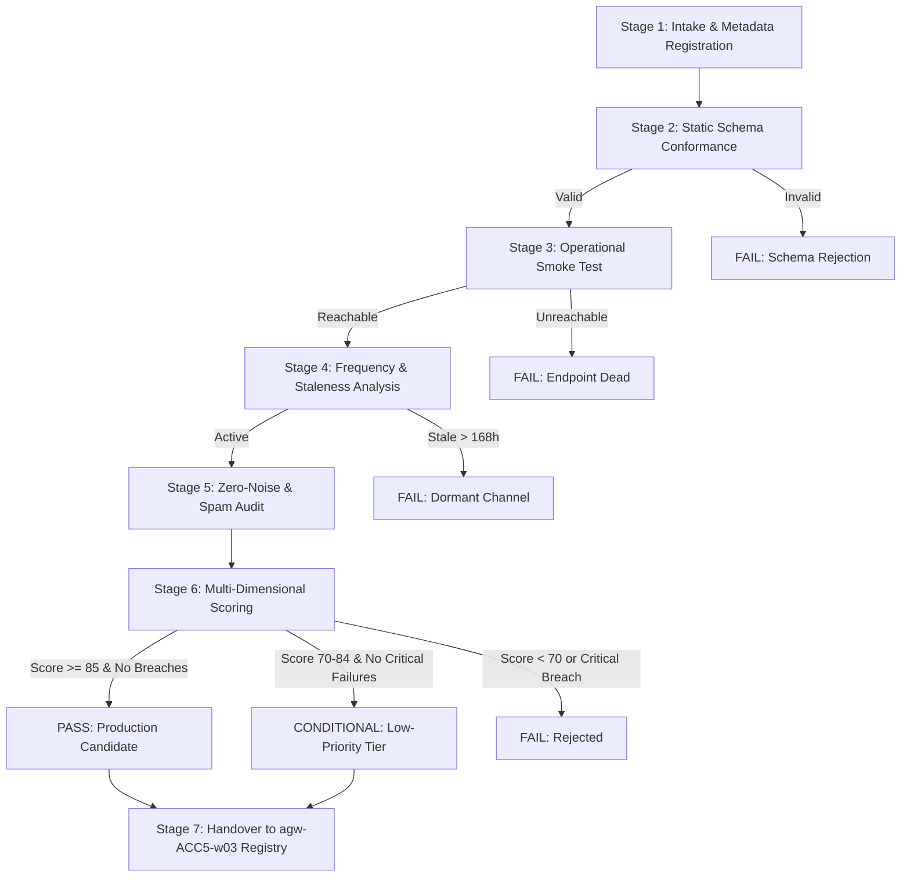

# Standardized QA Criteria, Acceptance Thresholds, and Verification Procedures for Candidate Feeds

**Owner:** Account 5 Lead (`agw-ACC5-w01` / `kidding602`)  
**Author:** `agw-ACC5-w02` (QA Criteria & Feed Smoke Testing)  
**Governance Scope:** Candidate Channel Evaluation, Feed Smoke Testing, and Pipeline Ingestion Governance  
**Target Repository:** `mohammadlali0707-stack/agw-workers` (and fleet worker nodes)  
**Date:** 2026-10-23  

---

## 1. Purpose and Operational Context

In response to organizational mandate **Issue #91** (*"کاهش اولویت کانال‌های تلگرامی بدون خروجی و جستجو برای سورس‌های جدید"*), the fleet is restructuring its source ingestion pipeline. While Account 2 audits and deprioritizes dead/dormant channels and Account 8 discovers candidate alternative channels, **Account 5** establishes the quality assurance barrier.

This document establishes the binding quality standards, metric thresholds, and verification procedures required before any candidate Telegram channel or content feed is approved for ingestion into production registries.

No channel may enter active polling without successfully clearing this verification procedure.

---

## 2. Core Quality Dimensions and Acceptance Thresholds

Every candidate channel is evaluated across four orthogonal quality dimensions. Each dimension has strict quantitative thresholds that define **Pass**, **Conditional**, or **Fail** statuses.

| Dimension | Metric | Hard Acceptance Threshold | Evaluation Method |
|---|---|---|---|
| **1. Operational Stability** | Endpoint Reachability | **100%** HTTP 200 / MTProto ACK | Ping & HTTP HEAD/GET smoke check |
| | Connection Latency | **p95 < 2500 ms**; Mean < 1500 ms | 5-sample latency probe |
| | Extraction Failure Rate | **0.0%** parsing error rate | Feed parser & HTML/JSON extractor |
| **2. Message Schema Validity** | JSON Schema Compliance | **100%** conformant to `channel_message_schema.json` | Draft-07 JSON Schema validation |
| | Required Field Completeness | **100%** present (`message_id`, `timestamp`, `content_type`, `text`, `views`, etc.) | Structural syntax check |
| | Encoding & Text Integrity | Valid UTF-8, zero corrupted codepoints, Persian glyph normalization | Unicode NFC parser |
| **3. Update Frequency Health** | Average Publication Cadence | **>= 0.5 posts/day** (1 post every 48h) | 14-day publication window audit |
| | Maximum Staleness | **<= 168 hours (7 days)** since last post | Current timestamp vs. latest post |
| | Anti-Flood / Burst Limit | **<= 20 posts/hour** | Rolling 1-hour window check |
| | Cadence Regularity Index | **>= 0.60** (normalized posting interval variance) | Interval standard deviation analysis |
| **4. Zero-Noise Performance** | Sponsored / Ad Post Ratio | **<= 5.0%** (target 0.0%) | Regex keyword scanner & sponsored tag filter |
| | Duplicate Message Rate | **0.0% exact duplicates**; < 2.0% near-duplicates | SHA-256 content hash & Jaccard index |
| | Minimum Substantive Content | **>= 25 characters** per post (excluding boilerplate) | Text length distribution filter |
| | Link Farm / Spam Ratio | **<= 2.0%** spam domain presence | Domain reputation & affiliate tag matcher |

---

## 3. Standard Verification Procedures (7-Stage SOP)

### Stage 1: Intake & Metadata Registration
1. Assign unique candidate identifier (`cand-<category>-<seq>`).
2. Verify canonical Telegram handle format (`^@[a-zA-Z0-9_]{4,32}$`).
3. Classify into primary domain category:
   - `ai_tech`: AI models, agentic frameworks, developer tools.
   - `game_development`: Godot engine, shaders, 3D pipelines, game assets.
   - `automation_devops`: CI/CD pipelines, runner orchestration, event dispatching.
   - `narrative_audio`: Sound design, voice acting, dialogue, ambient audio.
   - `persian_ui_typography`: RTL rendering, typography, Persian localization.
   - `general_tech`: Operating systems, networks, developer infrastructure.

### Stage 2: Static Schema Conformance Check
1. Validate candidate definition against [`candidate_channel_schema.json`](qa/schemas/candidate_channel_schema.json).
2. Validate all historical sample messages against [`channel_message_schema.json`](qa/schemas/channel_message_schema.json).
3. Any missing required attribute (`message_id`, `timestamp`, `content_type`, `text`, `views`) immediately triggers a **CRITICAL FAILURE**.

### Stage 3: Operational Smoke Test
1. Execute connection probe to the declared `operational_endpoint`.
2. Confirm HTTP status code matches `expected_status` (HTTP 200).
3. Verify latency within bounds (p95 < 2500 ms).
4. Verify response payload integrity (valid HTML preview or JSON bridge stream).

### Stage 4: Historical Cadence and Staleness Profiling
1. Sort sample message timestamps in strictly ascending chronological order.
2. Calculate time delta between latest post and current evaluation time:
   $$\Delta t_{latest} = t_{now} - t_{max}$$
   If $\Delta t_{latest} > 168\text{ hours}$, flag as **DORMANT (FAIL)**.
3. Compute average publication cadence:
   $$R_{pub} = \frac{N_{posts}}{\Delta t_{span} \text{ (days)}}$$
   Acceptance requires $R_{pub} \ge 0.5\text{ posts/day}$.

### Stage 5: Zero-Noise, Duplication, and Content Integrity Audit
1. **Promotional Keyword Scan**: Inspect message texts and tags for promotional patterns:
   - Persian keywords: `#تبلیغ`, `#تبلیغات`, `خرید سرور`, `تخفیف ویژه`, `قرعه‌کشی`, `ادمین تبلیغات`, `پشتیبانی فروش`.
   - English markers: `#ad`, `#sponsored`, `affiliate`, `promo code`.
2. **Duplicate Detection**: Compute SHA-256 hash of normalized text for each message. Count identical hashes:
   $$\text{DupRate} = \frac{N_{duplicate}}{N_{total}} \times 100\%$$
   Must be **0.0%**.
3. **Signal-to-Noise Ratio (SNR)**: Ensure average substantive text length >= 25 characters and non-boilerplate ratio >= 98%.

### Stage 6: Scoring Algorithm & Multi-Tier Classification
The overall QA composite score $S \in [0, 100]$ is computed via weighted formulation:

$$S = 0.25 \cdot S_{stability} + 0.30 \cdot S_{schema} + 0.25 \cdot S_{cadence} + 0.20 \cdot S_{noise}$$

Where:
- $S_{stability} = 100 \times \text{ReachabilityRatio} \times \min(1, \frac{2500}{\text{Latency}_{p95}})$
- $S_{schema} = 100 \times \frac{N_{valid\_messages}}{N_{total\_messages}}$
- $S_{cadence} = 100 \times \min(1, \frac{R_{pub}}{0.5}) \times \max(0, 1 - \frac{\Delta t_{latest}}{168})$
- $S_{noise} = 100 \times (1 - \text{AdRatio}) \times (1 - \text{DupRate})$

**Classification Rules**:
- **PASS**: $S \ge 85.0$, zero critical failures, valid schema (100%), no staleness breach, ad ratio $\le 5\%$.
- **CONDITIONAL**: $70.0 \le S < 85.0$, zero critical schema/stability failures. Channel exhibits minor cadence irregularity or low frequency; admitted to Low-Priority / extended polling tier (e.g. 360-720 min poll interval).
- **FAIL**: $S < 70.0$, or ANY critical failure:
  - Critical 1: Endpoint unreachable / HTTP error.
  - Critical 2: Schema validation failure (> 0 invalid messages).
  - Critical 3: Dormant / Stale feed ($\Delta t_{latest} > 168\text{ hours}$).
  - Critical 4: High noise / spam ($\text{AdRatio} > 15\%$ or duplicate flooding).

### Stage 7: Pipeline Handover to Source Registry
Approved candidates (**PASS** and approved **CONDITIONAL**) are structured into standard registry JSON format and forwarded to subordinate worker **`agw-ACC5-w03`** (*Source Registry Assembly and Pipeline Integration*) for production configuration.

---

## 4. Remediation and Continuous Monitoring

1. **Re-Testing Window**: Failed candidates may be resubmitted after 14 days if the channel operator resolves schema or frequency deficiencies.
2. **Post-Ingestion Health Probes**: Active channels in the production registry are subjected to weekly automated smoke tests. If a registered channel experiences 3 consecutive cycles of staleness or exceeds noise thresholds, it is automatically routed to Account 2 for deprioritization or de-registration.
