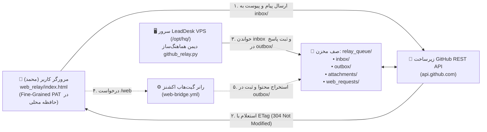

# کلاستر چت | رابط وب پشتیبان رله گیت‌هاب (GitHub Relay Web UI)

یک کلاینت وب استاتیک و مستقل (Zero-Dependency Static Client) جهت دسترسی پایدار به سامانه گفتگوی کلاستر (`cluster-chat`) در شرایط قطعی یا اختلال ارتباط مستقیم به آی‌پی سرور (اینترنت ملی ایران) از طریق رله امن مخزن گیت‌هاب.

---

## ۱. اهداف و معماری (Architecture Overview)

هنگام وقوع اختلالات شبکه یا محدودسازی مسیریابی به سمت سرورهای خارج از کشور، دسترسی مستقیم به آی‌پی اختصاصی VPS یا دامنه‌های متصل مسدود می‌گردد، اما معمولاً دسترسی به دامنه‌های `github.com` و `api.github.com` پایدار باقی می‌ماند.

این کلاینت وب استاتیک (`web_relay/`) طراحی شده است تا محمد بتواند به صورت مستقیم از طریق مرورگر (چه به صورت فایل محلی `file:///` روی لپ‌تاپ یا گوشی موبایل POCO Android، و چه میزبانی‌شده روی **GitHub Pages**)، بدون نیاز به هیچ سرور واسط دیگری، با ایجنت‌های هوشمند کلاستر (از جمله آرگون و ورکرها) گفتگو کند.



---

## ۲. قابلیت‌های کلیدی (Key Features)

1. **بدون وابستگی و بدون نیاز به بیلد (Zero Build Step):**
   - پیاده‌سازی شده فقط با سه فایل استاندارد `index.html`، `styles.css` و جاوااسکریپت خام (`crypto.js` و `app.js`).
   - قابل اجرا به سادگی با دوبار کلیک روی فایل `index.html` در مرورگر بدون نیاز به Node.js یا وب‌سرور محلی.

2. **طراحی واکنش‌گرا و دوجهته (RTL/LTR Responsive Dark UI):**
   - پوسته تیره مدرن با کنتراست بالا مطابق هویت بصری کلاستر چت.
   - بهینه‌سازی شده برای صفحات موبایل (POCO Android) و دسکتاپ بدون تداخل دکمه‌ها یا اسکرول افقی ناخواسته.
   - پشتیبانی از متن دوجهته (`dir="auto"`) برای نمایش روان و بدون درهم‌ریختگی پیام‌های فارسی و بلوک‌های کد/لینک‌های انگلیسی.

3. **امنیت توکن و عدم نشت اطلاعات:**
   - توکن دسترسی اختصاصی (Fine-Grained PAT) منحصراً در حافظه مرورگر (`sessionStorage` یا `localStorage` به انتخاب کاربر) نگهداری می‌شود.
   - توکن هرگز در هیچ کامیت گیت، لاگ یا سرور واسطی ذخیره یا ارسال نمی‌شود و فقط در هدر ارتباط با `api.github.com` قرار می‌گیرد.
   - مجهز به موتور پاکسازی خودکار کلیدها و توکن‌ها (`RelayCrypto.scrubSecrets`) قبل از خروج پیام از مرورگر.

4. **رمزنگاری سرتاسری اختیاری (E2E AES-256-GCM):**
   - سازگار با ماژول پایتون سرور (`cluster_chat/relay_protocol.py`).
   - استفاده از **WebCrypto API** بومی مرورگر (`window.crypto.subtle`) جهت مشتق‌سازی کلید با PBKDF2-HMAC-SHA256 (۱۰۰,۰۰۰ دور) و رمزنگاری داده‌ها با AES-256-GCM (کلید ۲۵۶ بیتی و IV تصادفی ۹۶ بیتی).

5. **مدیریت سهمیه درخواست‌های گیت‌هاب (ETag Caching):**
   - تمام استعلام‌ها با هدر شرطی `If-None-Match` ارسال می‌شوند.
   - پاسخ‌های `304 Not Modified` هیچ سهمیه‌ای از سقف ۵,۰۰۰ درخواست در ساعت گیت‌هاب مصرف نمی‌کنند.

6. **پشتیبانی از اتاق‌های گفتگوی کلاستر:**
   - اتاق عمومی: `main`
   - اتاق پیام مستقیم به آرگون: `dm-argon`
   - اتاق ورکرها و عملیات: `workers`

7. **پیوست فایل و تصاویر تا ۴ مگابایت:**
   - امکان ارسال عکس و اسناد با کشیدن و رها کردن (Drag & Drop) یا انتخاب فایل.
   - ذخیره‌سازی قطعات باینری به صورت Base64 استاندارد در مسیر `relay_queue/attachments/att_<hash>_<name>.json`.
   - امکان پیش‌نمایش تصویر و دانلود مستقیم از رابط وب.

8. **پل اینترنت آزاد از طریق رانر (Web Bridge):**
   - دستور متنی `/web <url>` یا فرم گرافیکی پنجره Web Bridge.
   - فعال‌سازی خودکار گردش‌کار گیت‌هاب اکشنز (`.github/workflows/web-bridge.yml`) جهت واکشی سایت‌های مسدود یا تحریم‌شده، تبدیل هوشمند HTML به Markdown تمیز، و تحویل مستقیم نتیجه در اتاق چت مربوطه.

---

## ۳. راهنمای گام به گام راه‌اندازی (Setup Guide)

### مرحله ۱: ساخت توکن Fine-Grained PAT در گیت‌هاب
1. به حساب گیت‌هاب خود وارد شده و به مسیر **Settings** > **Developer Settings** > **Personal access tokens** > **Fine-grained tokens** بروید.
2. روی دکمه **Generate new token** کلیک کنید.
3. مشخصات زیر را تنظیم نمایید:
   - **Token name:** `cluster-chat-web-relay`
   - **Expiration:** مثلاً ۹۰ روز یا ۱ سال
   - **Repository access:** فقط مخزن `mohammadlali0707-stack/agw-workers`
   - **Permissions:**
     - `Contents`: دسترسی **Read and write** (جهت خواندن و نوشتن صف پیام‌ها و پیوست‌ها)
     - `Actions`: دسترسی **Read and write** (جهت اجرای وب‌بریج از طریق فراخوانی دیسپچ ورک‌فلو)
4. توکن تولیدشده را کپی کنید.

### مرحله ۲: اجرای رابط کاربری

#### روش الف: اجرای مستقیم فایل در مرورگر (پیشنهادی و فوری)
فایل `web_relay/index.html` را در مرورگر سیستم خود باز کنید (`file:///.../web_relay/index.html`).

#### روش ب: استقرار روی GitHub Pages
1. در مخزن `agw-workers` به بخش **Settings** > **Pages** بروید.
2. منبع استقرار (Source) را روی شاخه کاری خود (مثلاً `main`) و پوشه `/web_relay` تنظیم کنید.
3. آدرس صفحه استاتیک (مثلاً `https://mohammadlali0707-stack.github.io/agw-workers/`) به راحتی در دسترس خواهد بود.

---

## ۴. نحوه کار با رابط وب (User Guide)

### ورود به تنظیمات و برقراری ارتباط
1. در بالای صفحه روی آیکون ⚙️ (تنظیمات) کلیک کنید.
2. پارامترها را بررسی کنید:
   - **GitHub Owner:** `mohammadlali0707-stack`
   - **Repository:** `agw-workers`
   - **Branch:** `main` (یا شاخه صف مانند `relay-state`)
   - **Fine-Grained PAT:** توکن مرحله قبل را پیست کنید.
   - **Shared Passphrase:** در صورتی که روی سرور VPS کلید رمزنگاری تعیین شده است، همان عبارت را وارد کنید تا پیام‌ها قفل‌گذاری و رمزگشایی شوند.
3. روی دکمه **ذخیره و اتصال** کلیک کنید.
4. نشانگر وضعیت در بالای صفحه به رنگ سبز درآمده و سهمیه درخواست باقی‌مانده (مثلاً `4985/5000`) نمایش داده می‌شود.

### ارسال پیام و پیوست فایل
- متن مورد نظر خود را در نوار ورودی پایین تایپ کنید و کلید **Enter** را بزنید.
- جهت ایجاد خط جدید از **Shift + Enter** استفاده کنید.
- با کلیک روی آیکون 📎 می‌توانید تصاویر یا فایل‌ها را ضمیمه کنید (حداکثر سقف مجاز برای هر فایل ۴ مگابایت است).

### استفاده از وب‌بریج (Web Bridge)
جهت دریافت متن یا محتوای یک سایت خارجی که از داخل کشور قابل دسترسی نیست:
1. در چت تایپ کنید:
   ```
   /web https://en.wikipedia.org/wiki/Internet_censorship
   ```
   یا برای دانلود فایل خام/باینری:
   ```
   /web --mode=file https://example.com/document.pdf
   ```
2. یا روی دکمه **🌐 Web Bridge** در نوار بالای صفحه کلیک کرده و آدرس و حالت استخراج (Markdown/HTML/File) را انتخاب نمایید.
3. رانر گیت‌هاب با حفاظت ضد SSRF آدرس را واکشی نموده و نتیجه را به صورت یک پیام جدید در همان اتاق ارسال می‌کند.

---

## ۵. مشخصات فنی و ساختار فایل‌ها (File Structure)

```
web_relay/
├── index.html       # ساختار استاندارد رابط کاربری، تب‌های اتاق‌ها، مودال تنظیمات و وب‌بریج
├── styles.css       # پوسته تیره مدرن، استایل‌های واکنش‌گرا و مدیریت متون دوجهته فارسی/انگلیسی
├── crypto.js        # ماژول رمزنگاری WebCrypto AES-256-GCM، تابع هش msg_id و تصفیه توکن‌ها
├── app.js           # کنترلر کلاینت، ارتباط با گیت‌هاب، کشینگ ETag، پردازش پیوست‌ها و رابط چت
└── README.md        # مستندات و راهنمای جامع عملیاتی به زبان فارسی
```

---

## ۶. عیب‌یابی (Troubleshooting)

- **خطای 401 Unauthorized:** توکن PAT اشتباه است یا منقضی شده است. در تنظیمات توکن را بروز کنید.
- **خطای 404 Not Found در ارسال پیام:** شاخه تنظیمی (Branch) در مخزن وجود ندارد. مطمئن شوید نام شاخه دقیقاً با شاخه مخزن مطابقت دارد.
- **نمایش آیکون 🔒 خطا در رمزگشایی:** پیام توسط فرستنده با کلید رمزگذاری شده است اما عبارت محرمانه (Passphrase) وارد شده در تنظیمات شما نادرست است یا خالی است.
- **عدم دریافت پاسخ در وب‌بریج:** بررسی کنید که آیا دسترسی `Actions: Read and write` به توکن PAT شما اختصاص داده شده است یا خیر.
